# Phase 1 — Recon & Surface Map: Pons Family (ponsfamily.com)

Status: CLOSED. Evidence legend: [ONCHAIN] · [OBSERVED] (artifact path / capture) · [DOCS] (URL) · [UNKNOWN].

Primary artifacts: `raw/docs-snapshots/` (v1 docs, v2 docs, launchpad/create/plp/analytics/builders/support pages, sitemap, robots, response headers), `raw/bundles/` (49 JS chunks + 2 HTML pages), `raw/captures/` (17 API probes), session-1 browser observation (logs rows 120–134).

---

## 1. Identity and official surface

| Item | Value | Evidence |
|---|---|---|
| Operator | Pons Labs, LLC ("© 2026 Pons Labs, LLC") | [OBSERVED] footer, all pages |
| Positioning | "noncustodial software interface… not a bank, broker, exchange, custodian, or investment adviser" | [OBSERVED] footer disclaimer |
| Brand rule | write "pons" lowercase; no implied partnership | [DOCS] v1 §Terms and attribution |
| Domains | ponsfamily.com (app), docs.ponsfamily.com (docs; `/` = v1, `/v2` = v2), balancesapi.ponsfamily.com (service, Cloudflare-fronted) | [OBSERVED] headers, bundle |
| Contact | contact@ponsfamily.com | [DOCS] |
| Socials/code | "Pons on X", "Pons on GitHub" links in sidebar; exact handles/orgs not captured | [OBSERVED] snapshot refs e29/e30 → [UNKNOWN] OQ-1.1 |
| Legal pages | /terms, /privacy, /takedown, /law-enforcement, "MiCA Whitepaper" (link target 404 at /whitepaper → [UNKNOWN] OQ-1.2) | [OBSERVED] sitemap + footer |
| Lookalikes | ponz.family, pons.family etc. treated as untrusted; never visited | mission rule |

---

## 2. Route map

From `sitemap.xml` (6,006 URLs: 8 static + ≈5,998 `/launchpad/0x…` token pages, hourly lastmod) [OBSERVED `raw/docs-snapshots/ponsfamily.com_sitemap.xml.html`], `robots.txt` (Disallow `/api/`, `/restricted`, `/ref/`) and footer/sidebar links.

```mermaid
flowchart TD
  A[ponsfamily.com] --> L[/launchpad — discovery feed/]
  L --> T[/launchpad/0xTOKEN — token page/]
  A --> C[/launchpad/create — 2-step create flow/]
  A --> P[/profile and /profile/ADDRESS — identity, launches, positions/]
  A --> AN[/analytics — Dune-sourced dashboard/]
  A --> PLP[/plp — Pons Liquidity Pool, coming soon/]
  A --> B[/builders — partnership intake form/]
  A --> S[/support/]
  A --> R[/ref/… — referral links, noindex/]
  A --> X[/restricted — geo or wallet-screening landing/]
  A --> LG[/terms /privacy /takedown /law-enforcement/]
  A --> API[/api/* — 35 route handlers/]
  D[docs.ponsfamily.com] --> D1[/ v1 protocol + integration/]
  D --> D2[/v2 protocol + integration + audits/]
  E[balancesapi.ponsfamily.com] -. wallet balances service .-> T
```

Route details [OBSERVED]:
- `/launchpad`: sidebar (Create a token, Launches, PLP, Analytics, Theme, Sign in), search combobox "Search tokens and people", trending carousel, filter tabs (market cap / new / active / graduation status), pair filter ("Any pair" + approved pairs, minus geo-restricted equity pairs), token cards with badges: "Serial deployer, N launches", "Pons Verified", "Community" (CTO), whitelist icon ("Whitelist used. The creator exempted N wallets from the launch snipe tax").
- `/launchpad/[token]`: TradingView-style chart (timeframes, indicators), buy/sell order tabs with slippage, stats (holders ≈18k, trades >110k on the sampled token, supply 1B, community earnings $527.9K), "Holder fee sharing" module (Rounds paid 1,583 / Last round $51.60 / Next round $830.26), launch-to-graduation time (24 min on the sample), geo-gating for equity-paired tokens ("restricted in your region"), socials, holders list, trades feed.
- `/launchpad/create`: Step 1 "Identity" (image, name, ticker, description, socials: twitter/telegram/discord/website/farcaster, live preview card) → Step 2 "Economics" (creator fee recipient, creator tax, buyback toggle, quote asset, snipe-tax exemptions/bundle wallets, opening buy). Launch fee 0.0005 ETH.
- `/plp`: "Coming soon — The Pons Liquidity Pool opens soon. Back a token with ETH and earn from the big trades your deposit cushions."
- `/analytics`: client-rendered; bundle references Dune.
- `/builders`: intake form (Your token: On Pons / Not on Pons; contract address with "sign in with the wallet that launched it"; needs: technical support, marketing, ecosystem alignment, partnership/integration).
- `/profile`: identity (username, display name, avatar, banner), X link, launches, stats (launched, live, graduated, market cap), positions view.

---

## 3. User roles and journeys

| Role | Entry | Core journeys | Evidence |
|---|---|---|---|
| Trader | /launchpad | discover → token page → sign in (embedded or external wallet) → buy/sell with slippage → portfolio in /profile?view=positions; receives push notifications | bundle (`/api/profile/${e}?view=positions`, `/api/push/subscription`) |
| Creator | /launchpad/create | 2-step create → pay 0.0005 ETH + opening buy → manage fee recipient / buyback toggle → claim fees from escrow → optional CTO handover | docs v2 §Creator controls, §Payouts |
| Holder (fee-share recipient) | token page | when creator sets fee recipient to a distributor contract, holders receive periodic rounds ("Holder fee sharing") | API `fees.recipient: "holders"`, `fees.distributor`, `fees.payouts` [OBSERVED `raw/captures/api_launches_50.json`] |
| Referrer | /ref/… | referral link (noindex) → attribution; mechanics not captured | robots.txt → [UNKNOWN] OQ-1.3 |
| Sponsor | create flow | `/api/sponsor/x-resolve?handle=` resolves an X handle → sponsored launch for a personality | bundle → semantics [UNKNOWN] OQ-1.4 |
| Community (CTO) | CTO form | request takeover → team review → voluntary transfer or 3-day timelocked protocol proposal | docs v2 §Community takeovers |
| Migrator | migration contract | deposit dead coin in epochs → paced TWAP sale → claim replacement token (90-day window) | docs v2 §Migration; `/api/tokens/migrations` lists 6 tokens |
| Verified creator | /profile/verified, X OAuth | link X (`/api/x/callback`), get "Pons Verified" badge; `/api/tokens/verified` list | bundle, capture |
| Admin (Pons Labs) | Safe 2-of-3 | params, pair approvals, launcher whitelist, CTO proposals, graduation rescue, fee rescue | Phase 2 |
| Keeper | EOA 0xa101… | fee sweeps, buybacks, migration sales, unclaimed-fee routing | Phase 2, docs v1 |
| Integrator | docs, /builders | index events, derive prices, request quote-asset approval, testnet addresses on request | docs v2 §Support |

Click-depth (session-1 observation): discover→trade = 2 pages + 1 wallet modal; create = 2 steps + 1 tx (atomic launch-and-buy). Onboarding friction is low: embedded wallet (Turnkey) means no extension required; Cloudflare Turnstile gates human checks (`/api/human`).

---

## 4. Documentation extraction

### 4.1 v1 docs (Gen1/Gen2 protocol) [DOCS https://docs.ponsfamily.com]
- No bonding curve, no migration; token launches directly into its own Uniswap V3 WETH pool; liquidity locked automatically.
- Fixed supply 1,000,000,000; pool fee 1% (10000); launch fee 0.0005 ETH.
- Launch protection: first two blocks after launch protected; on the launch block only the creator's initial buy executes; for the rest of the window each wallet may hold ≤5% of supply and buy ≤5.5%; sells and transfers never restricted.
- Graduation: WETH paired principal ≥ 4.2 ETH; "not a quality signal"; nothing migrates.
- Fees: LP fees in token + WETH; split snapshotted per token; current 70/30 creator/protocol from block 8,991,118; legacy 90/10 from block 8,600,612; unclaimed creator rewards may be claimed and routed by pons automation.
- Protocol revenue: 80% of protocol fees → PONS buyback via automated TWAP and burn ("not immutable yet"); 20% → infrastructure and team. Burn-adjusted market cap shown.
- CTO: via form, administrative review; changes only payout wallet and creator surfaces.
- Risk disclosures; integration guide (TokenLaunched topic0 0xdb51ea9a…, Swap topic0 0xc42079f9…, `graduationStatus`, `getLaunchedToken`, locker `tokenProtocolFeeShares`, `feeRedirects`), reference token PONS, ETH/USD from DeFiLlama, chunked `eth_getLogs` advice.

### 4.2 v2 docs (live protocol) [DOCS https://docs.ponsfamily.com/v2]
- Lifecycle: Create → Trade the curve → Graduate → Pool (Uniswap v4, liquidity locked permanently); graduation auto in the finishing buy, else anyone can push it.
- Curve: fixed starting price; fees in quote asset only (buy: on spend; sell: on receipt); selling closes once sold out; partial fill + refund on the final buy; price-per-token protection preserved.
- Graduation: fixed reserved share → identical pool size/price for every launch on the same settings.
- Custom pairs: ETH default; approved tokens only (tokenized stocks, stablecoins); quote asset fixed per launch; creator paid in that asset; extra risk disclosed.
- Snipe protection: 99% → 0 over "the first 5 seconds" (≈25% at 1 s, ≈3% at 2 s); buys only; collected tax joins the trading fee; terms snapshotted per launch; creator + fee recipient auto-exempt; extra exemptions fixed at creation.
- Fees: standard fee (pons share first → optional buyback slice from the remainder → creator) + optional capped creator tax (100% creator); same rates pre/post graduation; pool fee 0.
- Payouts: pull-balances per quote asset; post-graduation memecoin-side fees converted with capped price impact.
- Buyback & vesting: creator-funded, optional; locked 5 years; weighted clock; either side can release both shares; skipped if illiquid.
- Creator controls: only fee destination and buyback on/off (pons can turn off, never on).
- CTO: voluntary (instant) or pons proposal (3-day wait, 3-day execution window, public).
- Migration: for coins pons did not launch; epochs with declining credit rates and caps; mandate minimum; paced TWAP sales with minimum output; replacement pool opens at prior market price; linear claim vesting; 90-day claim window; rescue path.
- Safety: liquidity + leftover supply locked forever; two-step graduation with 7-day rescue; marked permanently if rescued.
- Integration: contracts list (incl. Launch locker 0x267444D0…), launch configs, deterministic CREATE2 addresses, exemptions, launch-and-buy, quote asset selection, buy/sell, pushing stalled graduation, quoting (asymmetric directions, partial fills), state reading (phases, reserves, price/progress, fee rates, metadata, buyback vest, pending takeovers), claiming fees (escrow after sweep), events to index, v4 pool reconstruction, hook behavior, sweeping, errors glossary.
- Audits: SB Security, Dingbats, Pashov Audit Group — all in progress; "treat v2 as unaudited". Public launches "closed… check canLaunch".
- Support: testnet addresses available on request.

### 4.3 Discrepancies (docs vs chain) — carried to Phase 2 and `_open-questions.md`
- Snipe window 5 s (docs) vs 3 s (factory). Launch gating closed (docs) vs `launchEnabled=true` (chain, 2026-10-23).

---

## 5. Public footprint (collected in session 1 via search summaries; URLs unresolved — OQ-6.1)
- The Block (analyst Wazz): ≥$18.43M extracted across 53 launches via snipe-tax whitelist bundling, Jul 10–Sep 21 2026.
- The Defiant / others: Pools.trade (Uniswap Labs) launched Aug 5 2026 on Robinhood Chain with 0 launch fee, 0.25% trade fee, Instant Launch (curve) + Crowd Launch (4-hour continuous clearing auction); captured ~40–54% of new launches shortly after.
- NOXA (noxa.fun) ceased launches Jul 11, dark Jul 13 2026.
- Mid-July: frontend authorization vulnerability patched; V2 launches paused for sniping fix, relaunched after patch + audit.
- Bot-inflated issuance metrics widely noted.
- Dune: analytics page sources Dune (bundle marker); specific dashboard URL [UNKNOWN] OQ-1.5.
- Bitquery docs reference Pons/Robinhood Chain data (search result) → alternative data source for Phase 5.

---

## 6. Passive infrastructure footprint

| Layer | Finding | Evidence |
|---|---|---|
| Hosting | Vercel (`server: Vercel`, `x-vercel-id: sfo1::sfo1::…` for app, `sfo1::iad1` for docs; deployment `dpl_GEnxfSpjSd3XoUUAoNoLS3HM5X3S`) | [OBSERVED] `raw/docs-snapshots/*.headers.txt`, `page_launchpad.html` |
| Framework | Next.js App Router with Turbopack (chunk names `turbopack-*.js`, `__next_f` RSC flight payload) | [OBSERVED] bundles |
| Security headers (app) | CSP frame-src only (Turnkey, WalletConnect/Reown, Cloudflare challenges); HSTS 2y; X-Frame-Options DENY; nosniff; Permissions-Policy camera/mic/geo off; referrer strict-origin-when-cross-origin | [OBSERVED] |
| Security headers (docs) | Full nonce-based CSP with `strict-dynamic`, `frame-ancestors 'self'`, `upgrade-insecure-requests`; HSTS 1y includeSubDomains | [OBSERVED] |
| Caching | HTML `private, no-cache, no-store`; public API lists `cache-control: public` with Vercel edge (`x-vercel-cache: HIT/MISS`); personalized endpoints `no-store` | [OBSERVED] `raw/captures/*.headers` |
| Wallets | Turnkey embedded wallets (auth.turnkey.com, export.turnkey.com, `/api/turnkey/delegated-public-key`), Reown AppKit / WalletConnect, Coinbase Wallet SDK, SIWE nonce flow | [OBSERVED] CSP + bundle |
| Bot/abuse | Cloudflare Turnstile (`challenges.cloudflare.com`, `/api/human`), wallet screening ("Pons screens wallets…" → restricted modal), geo-gating (`countryCode`, `equityPairsRestricted`) | [OBSERVED] bundle |
| Realtime | Ably (channels/events `token.created`, `token.updated`) | [OBSERVED] bundle |
| Balances | balancesapi.ponsfamily.com behind Cloudflare (`server: cloudflare`, `cf-cache-status: DYNAMIC`) | [OBSERVED] |
| Media | IPFS artwork (`ipfs://bafy…` CIDs) served via `/api/artwork?src=` and `/api/ipfs/image` proxies | [OBSERVED] API + bundle |
| Oracle | DeFiLlama ETH price (docs); `quoteUsd` map per pair token in profile API | [DOCS], [OBSERVED] |
| Analytics | Vercel Analytics (bundle), Dune (analytics page) | [OBSERVED] |
| Social auth | X OAuth callback `/api/x/callback`; `/api/sponsor/x-resolve` | [OBSERVED] |
| Push | Web Push subscription `/api/push/subscription` + service worker | [OBSERVED] |
| RPC proxy | `/api/rpc` (provider behind it [UNKNOWN] OQ-4.2) | [OBSERVED] |
| Error telemetry | `/api/client-errors/wallet`; no Sentry/PostHog markers found | [OBSERVED] |

---

## 7. Feature inventory

| Feature | Where | How it works | Evidence |
|---|---|---|---|
| Discovery feed + trending | /launchpad | `/api/launches?sort=…&limit=…`, `/api/launches/trending` (volumeUsd, trades, traders, change), sparklines; Ably live updates | captures, bundle |
| Multi-quote launches | create, feed filter | approved pair tokens (ETH, USDG, TAO, cbBTC, tokenized stocks); equity pairs geo-restricted | [ONCHAIN] + bundle |
| Bonding curve trading | token page | curve `buy/sell` via wagmi; `/api/trade/route` for routing/quotes; `eth_simulateV1` for simulation | bundle |
| Graduation progress | token page | `raisedQuote/thresholdQuote`, `stage` (curve/graduated), `graduatedAt` | API schema |
| Snipe-tax whitelist disclosure | cards, token page | `whitelisted: N` → tooltip | API + bundle |
| Creator tax + buyback | create step 2 | `creatorTaxBps`, `buybackEnabled`, `buybackLockedPct` | API + [ONCHAIN] |
| Holder fee sharing | token page | creator fee recipient = distributor contract; API `fees.{recipient:"holders", distributor, payouts, distributedQuote, distributedTokens, lastPayoutAt}` | capture `api_launches_50.json` |
| Pons Verified / Serial deployer / Community badges | cards | `/api/tokens/verified`, deployer stats, CTO flag | bundle |
| Profiles & identities | /profile | SIWE (`/api/profile/nonce`, `/api/session`), username claim, X linking, avatar/banner | bundle |
| Notifications | app | `/api/notifications?wallet=`, Web Push | bundle |
| Legal acceptance | first trade | `/api/legal/acceptance` per wallet | bundle |
| CTO | form | reviewed; on-chain transfer or timelocked proposal | docs v2 |
| Migration (dead-coin takeover) | contract + UI list | `/api/tokens/migrations` (6 tokens) | capture, docs v2 |
| PLP (liquidity backstop) | /plp | coming soon: deposit ETH to cushion big trades, earn | page |
| Analytics | /analytics | Dune | page, bundle |
| Builders intake | /builders | form | page |
| Referral | /ref/ | [UNKNOWN] | robots |
| Sponsorship | create | X-handle resolution | bundle |
| Theme toggle | sidebar | light/dark | observation |

---

## 8. UX notes (strengths / weaknesses) — feeds Phase 3 teardown
Strengths: embedded wallet onboarding; one-tx launch-and-buy; honest disclosures (whitelist tooltip, graduation "not a quality signal"); live trending; CTO and holder fee sharing as community primitives; docs are unusually candid and complete (v2).
Weaknesses: whitelist disclosure is passive (an icon) relative to its $18M impact; degraded-performance banner shows indexer freshness is a visible SPOF; docs lag chain (snipe window, gating); PLP announced but empty; equity pairs blocked by geography creates a confusing "Any pair" filter; two docs versions can confuse integrators (v1 says "no bonding curve").
