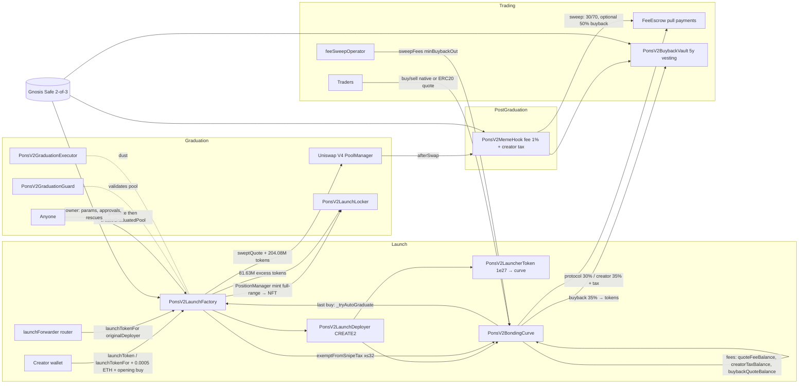
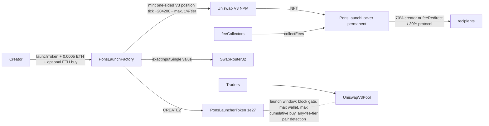

# Phase 2 — Smart Contract Reverse Engineering: Pons Family on Robinhood Chain

Status: CLOSED (session 2). Companion files: `formula-sheet.md` (math + worked examples), `incidents-and-security.md` (attacks, trust model, design lessons), `facts.json` (machine-readable), `verification/` (throwaway fork tests + scanner).

Evidence legend: [ONCHAIN] chain data (chainId 4663, address/tx/block given) · [OBSERVED] captured artifact (path given) · [DOCS] docs.ponsfamily.com · [UNKNOWN] unresolved → `_open-questions.md`.

---

## 0. Headline findings

1. **The mission's starting hypothesis was half wrong.** Pons shipped **three** contract generations in 3 weeks. Gen1 and Gen2 (both 2026-07-13) have **no bonding curve**: the whole supply is a one-sided Uniswap V3 range order, locked forever; "graduation" is a cosmetic 4.2 ETH badge. The curve-then-graduate model only exists in **V2** (2026-08-03), which is what the live app uses today. [ONCHAIN]
2. **V2 is a constant-product curve with a virtual reserve (1.68 ETH phantom), graduating at 4.2 ETH of real quote into a Uniswap V4 pool whose custom hook captures 100% of post-graduation fees (LP fee = 0).** Price continuity across graduation is exact; 8.16% of supply is permanently locked to achieve it. [ONCHAIN]
3. **Formulas are reproduced to the wei** on two real transactions (including the 618 bps snipe tax at t+1s) and in 3/3 live-fork Foundry tests. [ONCHAIN]
4. **The anti-snipe design is also the rug vector.** A 99% snipe tax decays by halvings over 3 s, but the creator can exempt up to 32 wallets in the launch tx. The Block / analyst Wazz attribute ≥ $18.43M extracted across 53 launches to exactly this whitelist-bundling pattern. [OBSERVED: web search summaries; exact URLs UNKNOWN]
5. **Two different "buybacks" exist and the word is overloaded.** (a) v1 docs: the *protocol* runs a manual/automated TWAP that spends 80% of protocol fees buying **PONS** and burning it ("not immutable yet"). (b) v2 code + v2 docs: a *per-launch* creator-funded buyback of the launch token, **locked 5 years** in the vault (70/30 creator/protocol on release). The v2 docs match the code; the v1 docs describe an off-chain treasury policy. Our design must not conflate the two. [ONCHAIN] + [DOCS v1/v2]
5b. **Docs lag chain on the snipe window**: v2 docs say the tax decays over **5 s** ("near 25% at 1 s, ~3% at 2 s" — consistent with W=5), but the factory reads `snipeTaxSeconds = 3`. Each curve snapshots its own window at launch, so older launches may carry 5 s. [DOCS v2] vs [ONCHAIN]
5c. **Audits**: v2 docs list three in-progress reviews (SB Security, Dingbats, Pashov Audit Group), none closed; docs say "treat v2 as unaudited". [DOCS v2]
5d. **Launch gating**: v2 docs say public launches are closed (whitelist only, check `canLaunch`), while the factory read `launchEnabled = true` on 2026-10-23 — either re-opened since the docs were written, or the docs are stale. [DOCS v2] vs [ONCHAIN]
6. **Governance = Gnosis Safe 2-of-3, no timelock, non-upgradeable contracts with hard-coded caps.** Trusted keeper EOA needed for fee sweeps/buybacks. [ONCHAIN]
7. **Multi-quote launches** (native ETH, USDG, TAO, cbBTC; tokenized stocks in UI) all share G/Q0 = 2.5, so curve geometry is identical across quote assets. [ONCHAIN]

---

## 1. Chain context

| Fact | Value | Evidence |
|---|---|---|
| Chain | Robinhood Chain, chainId 4663 (0x1237) | [ONCHAIN] `eth_chainId` |
| Stack | Arbitrum Orbit / Nitro (ArbSys precompile 0x…64 `arbChainID()` returns 4663) | [ONCHAIN] |
| Block time | ≈0.105 s (10,000-block sample) | [ONCHAIN] |
| RPC | https://rpc.mainnet.chain.robinhood.com — non-archival (historical state pruned within hours), 429 under load, WAF on non-browser UAs | [ONCHAIN] |
| Explorer | robinhoodchain.blockscout.com (Cloudflare-challenged for bots) | [OBSERVED] |
| Verification | Sourcify supports chain 4663 | [OBSERVED] `sourcify.dev/server/chains` |
| DEX infra | Uniswap V3 (factory block 8,930), V4 PoolManager (block 9,070), both deployed by 0x9701fb0aDe1E269c8f64Ec0C7b3cfADB31A13A52 near genesis; Permit2 canonical | [ONCHAIN] Sourcify deployment metadata |

---

## 2. Contract inventory

### 2.1 V2 — live protocol (UI `protocol: "v2"`, code `PonsV2*`)

| Role | Contract | Address | Deployer / block / tx | Verified | Compiler |
|---|---|---|---|---|---|
| Factory, config, fee policy, graduation orchestrator | PonsV2LaunchFactory | 0x7eD598BcEf8bd9Edd8C97A195C6d13f40801EC7e | 0xFdDE5a1E3cDF791Da71E49F817D70C7ceD72CC36 / 26,841,846 / 0x3817f297aa7c2ef78789bffac57491ceedc218fef962d47ed36c272699deddeb | Sourcify exact_match | solc 0.8.35, viaIR, runs 200, cancun |
| Uniswap V4 hook (post-grad fees) | PonsV2MemeHook | 0xE5e702641Ea86F4ae6cC3cDaeD2B886f976Be044 | same / 26,841,846 / 0x220a9825bb32374540a6c7f3d6e7c769de64430c7f2155484ad0344d1c955d4b | Sourcify match | 0.8.35 |
| Buyback vault (5y vesting) | PonsV2BuybackVault | 0x42df2a798f82289E177311362e8f5ccC45c1219c | same / 26,841,846 / 0x4ceb1e809d55f76045dce2ccd2335e9317b291b07b4d5994aa8b7cdd027af142 | Sourcify match | 0.8.35 |
| Pull-payment fee escrow | FeeEscrow | 0xd3AFEB2a57f70eF218Aa82451c51B2fb0416Ac9e | [UNKNOWN] | [UNKNOWN] | — |
| Graduation executor (dust) | PonsV2GraduationExecutor | 0xC7819B64A1dAECD7eC19856d026cb14EfBd89046 | [UNKNOWN] | source bundled in factory tree | 0.8.35 |
| Graduation guard (pool validation) | PonsV2GraduationGuard | 0xf5695117b99B6f6401e67d4195BD653628176C6C | [UNKNOWN] | bundled | 0.8.35 |
| Token+curve deployer (CREATE2) | PonsV2LaunchDeployer | 0x3711ceA4feaDE896C913C68F01Eda97Cb06D1A42 | [UNKNOWN] | bundled | 0.8.35 |
| Atomic launch-and-buy router | launchForwarder | 0xe33E9E479dF8802cb0866d5d05258bEc4cF62948 | [UNKNOWN] | [UNKNOWN] | — |
| LP-NFT + excess-supply locker | PonsV2LaunchLocker | 0x267444D099b10fB5Ed7c3Cc7B7c767AdcA574952 [DOCS v2 "Deployed addresses"; not yet re-read on-chain] | [UNKNOWN] | bundled | 0.8.35 |
| Per-launch bonding curve | PonsV2BondingCurve (one per token, CREATE2 by deployer) | e.g. 0xb9c425ff3706e17b061fda39bb9062999be542f9 | per launch | bundled | 0.8.35 |
| Per-launch token | PonsV2LauncherToken (plain ERC20, full supply minted to curve) | e.g. 0x65b101d4f151f1091874e2668b7f1f80268e9e8e | per launch | bundled | 0.8.35 |
| Protocol fee recipient | contract (≈4.8 KB code) | 0x31eA5b453A6Cd60F36203830DE046ff32DeC2CDB | [UNKNOWN] | [UNKNOWN] | — |
| Fee sweep operator (keeper) | EOA/bot | 0xa1018c1D9655292A2dE0F7dEa9a0F848EaA8cA83 | — | — | — |
| Owner | Gnosis Safe v1.4.1, threshold 2 of 3 | 0x263ed295dAFaE1d9AAdD6E56c4B6F9f38eE019Dd | signers 0x1320a2b04A9e9fF511c7209C9669EBFE13cC818e, 0x3825E7b3Ff17637b08219e99D78b6c622b73f5b7, 0xfA31fE751c203a623b52FaD26B4063aBc2ffdf50 | — | — |
| Uniswap V4 PoolManager | PoolManager | 0x8366a39CC670B4001A1121B8F6A443A643e40951 | 0x9701fb0a… / 9,070 | Sourcify match | 0.8.26 |
| Uniswap V4 PositionManager | PositionManager | 0x58daec3116aae6D93017bAAea7749052E8a04fA7 | [UNKNOWN] | — | — |
| Permit2 | Permit2 | 0x000000000022D473030F116dDEE9F6B43aC78BA3 | canonical | — | — |

All [ONCHAIN] unless marked. Address resolution: `cast call` on factory/hook getters (session 2) + Sourcify `deployment` metadata (`raw/sources/*.sourcify.json`).

### 2.2 Gen2 — "active factory" per docs, launching disabled

| Role | Contract | Address | Deployer / block / tx | Verified |
|---|---|---|---|---|
| Factory | PonsLaunchFactory | 0xA5aAb3F0c6EeadF30Ef1D3Eb997108E976351feB | 0xda4bCee76B29EFEc9697Fcf663601c2042043968 / 8,991,118 / 0x836c5e41d4a4162c922cb7f0cc6713018c40b32265fb3b63926b9fdfbe0c0e67 | exact_match, solc 0.8.30 viaIR cancun |
| Locker | PonsLaunchLocker | 0x736D76699C26D0d966744cAe304C000d471f7F35 | same / 8,991,102 / 0xb12910e168a0f59e522798a042741fa20b0bf47e100e598ca19ce2d42f483c70 | exact_match |
| Token impl (per launch, CREATE2) | PonsLauncherToken | per launch | — | bundled |
| Uniswap V3 Factory | UniswapV3Factory | 0x1f7d7550B1b028f7571E69A784071F0205FD2EfA | 0x9701fb0a… / 8,930 | match, 0.7.6 |
| NonfungiblePositionManager | NPM | 0x73991a25C818Bf1f1128dEAaB1492D45638DE0D3 | 0x9701fb0a… / 9,069 | match |
| SwapRouter02 | Router | 0xCaf681a66D020601342297493863E78C959E5cb2 | 0x9701fb0a… / 9,076 | match |
| QuoterV2 | Quoter | 0x33e885eD0Ec9bF04EcfB19341582aADCb4c8A9E7 | — | match |
| WETH | TransparentUpgradeableProxy (WETH9 impl 0xC6B81b429797E0f555440b70cD99e032D7AE947e) | 0x0Bd7D308f8E1639FAb988df18A8011f41EAcAD73 | — | exact_match (proxy) — note: upgradeable WETH is itself a trust assumption |

Live state [ONCHAIN]: `launchEnabled=false`, `launchFee=0.0005 ETH`, owner = Safe 0x263e…, `dexConfigCount=1` (uniswap v3, fee 10000, tickSpacing 200), `launchConfigCount=1` (WETH, G=4.2 ETH, initialTick −204200, supply 1e27, max-wallet/max-tx ≈5%/5.5%), locker `protocolFeeShare=30` (constructor arg was 10).

### 2.3 Gen1 — legacy, unverified, disabled

| Role | Address | Notes |
|---|---|---|
| Factory | 0x0c37a24F5D23A486FA692d1500881d698B1F77a4 | deployed block 8,600,612 (2026-07-13); unverified; REA `inspect-evm-interface` recovered 48 dispatch entries / 24 unique selectors — all resolve via `cast 4byte` to Gen2's ABI (`raw/bytecode/gen1-factory.*`); `launchEnabled=false`; owner = Safe 0x263e… |
| Locker | 0x31ca5E101941A93A7DD6d0497928700625CF54B5 | unverified; `protocolFeeShare=10` (90/10 legacy split) |
| PONS token | 0x39dBED3a2bd333467115dE45665cC57F813C4571 | PonsLauncherToken launched via Gen1 at block 8,963,150 by 0xB9F5f4Ea1AF1F5d3678470eb98e8FBdcadEb24b0; pool 0x10CC6BD38112cAc182db90B6a71d8Bb5939526bA (UniswapV3Pool). Its source differs from Gen2's bundled token. |

Timeline [ONCHAIN block timestamps]: Gen1 2026-07-13 → Gen2 2026-07-13 (+≈11 h, blocks 8.60M→8.99M) → V2 2026-08-03 (block 26.84M). Context: NOXA (prior #1 launchpad on the chain) stopped launches 2026-07-11 and went dark 2026-07-13; Uniswap Labs' Pools.trade launched 2026-08-05 [OBSERVED: search summaries, Phase 6].

---

## 3. Architecture

### 3.1 V2 (live)



### 3.2 Gen1/Gen2 (range-order model)



---

## 4. Per-contract spec sheets (V2)

### 4.1 PonsV2LaunchFactory (1,526 lines)

Purpose: single entry point for launches; holds launch configs, pair-token economics, fee policy, module wiring, CTO (fee-recipient transfer) governance, graduation orchestration.

Key external functions [ONCHAIN ABI `raw/abis/0x7eD598….abi.json`]:
- `launchToken(TokenParams, launchConfigId, pairToken)` and `launchToken(TokenParams, launchConfigId, pairToken, address[] snipeTaxExemptions)` — payable; `TokenParams {name, symbol, logo, description, Socials, creatorFeeRecipient, creatorTaxBps, buybackEnabled, bytes32 expectedEconomics, bytes32 salt}`. `expectedEconomics` must equal `previewLaunchEconomics(configId, pairToken)` — a hash commit so a creator cannot be front-run by an owner param change between quote and launch.
- `launchTokenFor(..., originalDeployer, exemptions)` — only `launchForwarder`; preserves the real deployer without `tx.origin` (AA-compatible).
- `canLaunch(launcher)` — `launchEnabled || whitelistedLaunchers[launcher]`.
- `graduate(token)`, `createGraduatedPool(token)` — permissionless, nonReentrant, two-phase.
- `transferCreatorFeeRecipient(token, newRecipient)` — self-service by current recipient; `proposeCreatorFeeRecipient` / execute / cancel — owner override with `CREATOR_FEE_RECIPIENT_TIMELOCK = 3 days` and `EXECUTION_WINDOW = 3 days` (the on-chain CTO mechanism).
- `setBuybackEnabled(token, enabled)` — creator-controlled per launch (`NotBuybackController`).
- `getLaunchedToken(token)` → `LaunchedToken {token, curve, deployer, creatorFeeRecipient, pairToken, graduationThreshold, poolFee, tickSpacing, creatorTaxBps, buybackEnabled, phase, sweptQuote, sweptTokens, sweptAt, exists}`.
- Owner: `addLaunchConfig/updateLaunchConfig`, `setLaunchFee`, `setLaunchEnabled`, `setWhitelistedLauncher`, `setMaxCreatorTax`, `setSnipeTaxStartBps`, `setSnipeTaxSeconds`, `setPairTokenApproval`, `setPairTokenEconomics`, `setGraduationExecutor/LaunchDeployer/LaunchForwarder`, `rescueGraduation` (after 7 days), `transferOwnership` (Ownable2Step), `renounceOwnership` disabled.

Constants [ONCHAIN source L58–107]: `MAX_CURVE_FEE_BPS 1000`, `MAX_CREATOR_TAX_CEILING_BPS 1000`, `MAX_TOTAL_TRADE_FEE_BPS 2000`, `MAX_SNIPE_TAX_START_BPS 9900`, `MAX_SNIPE_TAX_SECONDS 60`, `MAX_SNIPE_TAX_EXEMPTIONS 32`, `MIN_PAIR_TOKEN_DECIMALS 6`, `MIN_LAUNCH_SUPPLY 1e18`, `REFERENCE_BUY_DIVISOR 1e6`, `MAX_SEED_AMOUNT int128.max`, `CREATOR_FEE_RECIPIENT_TIMELOCK 3d`, `GRADUATION_RESCUE_DELAY 7d`.

Events: `TokenLaunched(token idx, curve idx, deployer idx, pairToken, launchConfigId, graduationThreshold)` topic0 0x8d4aad4953d0ca700d468f3753aa14432d1b35b43ec6409f051fb6aa43a89607; `PoolGraduated(token idx, positionId, tokenAmount, pairTokenAmount)`; `LaunchSwept`, `LaunchForceSwept`, `GraduationTokensPermanentlyLocked`, `LaunchGraduationRescued`, `CreatorFeeRecipient*`, config/param update events.

Errors (from bundle ABI, `raw/bundles/js/14-4wv1j-s73i.js`): `NativeValueMismatch`, `NotApprovedLauncher`, `NotBuybackController`, `NotVestBeneficiary`, `RefundFailed`, `ZeroAddress`, `ZeroAmount`, plus curve errors `CurveGraduated`, `AlreadyGraduated`, `SlippageExceeded(uint256,uint256)`, `MinimumOutputRequired`, `NotFeeSweepOperator`, `InternalSwapRequiresOperator`.

### 4.2 PonsV2BondingCurve (872 lines, one per launch)

State: see formula sheet §2. Immutables: `token`, `factory`, `deployer`, `pairToken` (address(0) = native), `feeBps`, `creatorTaxBps`, `phantomQuote`, `graduationThreshold`, `reservedTokens`, `launchSupply`, `launchedAt`, `snipeTaxStartBps`, `snipeTaxSeconds`, `buybackVault`, `feePolicy` (= factory, read live for `protocolFeeShareBps`, `buybackBurnBps`, `maxInternalPriceImpactBps`, `feeSweepOperator`, `protocolFeeRecipient`).

Functions: `buy(quoteIn, minTokensOut, recipient)` payable; `sell(tokensIn, minQuoteOut, recipient)`; `sweepFees(minBuybackTokensOut)`; `graduate(recipient)` onlyFactory; `exemptFromSnipeTax(account)` onlyFactory; `setCreatorFeeRecipient` onlyFactory; `setBuybackEnabled` onlyFactory; views `getReserves`, `sellableTokens`, `readyToGraduate`, `currentSnipeTaxBps(recipient)`, `quoteBuy/quoteSell`-style previews, `trackedQuote`, `trackedTokens`, `quoteFeeBalance`, `creatorTaxBalance`, `buybackQuoteBalance`.

Behavioral guarantees (from source): fee on quote leg only; partial fill + refund at the end; ratio-based slippage; sells closed when full; stranded donations; auto-graduation attempt in try/catch; buyback bounded by 3% reserve movement; everything paid via FeeEscrow (pull).

Events: `CurveBuy(buyer idx, recipient idx, quoteIn, tokensOut, fee, tax)`, `CurveSell(...)`, `CurveBuyRefunded`, `FeesSwept(protocol, buyback, creator)`, `BuybackLocked(quoteSpent, tokensLocked)`, `CurveCompleted(recipient, quoteOut, tokenOut)`, `SnipeTaxExempted(account)`, `SnipeTaxCharged(recipient, amount)`, `AutoGraduationFailed(token, gasRemaining)`, `FeesRescued`, `Initialized`.

### 4.3 PonsV2MemeHook (887 lines, singleton V4 hook)

Registered per pool at graduation (`PoolRegistered(poolId, memecoin, quoteToken, creator)`), stores `LaunchInfo {hookFeeBps, creatorTaxBps, creator recipient, buybackEnabled, registered}` snapshotted per pool. `afterSwap` takes `hookFeeBps + creatorTaxBps` of the unspecified currency; `sweepPoolFees` (operator for buyback/conversion paths) converts and splits 30/70 (+ optional 50% buyback → vault). Owner setters (Safe): `setProtocolFeeShare (≤5000)`, `setBuybackBurnBps`, `setHookFeeBps (≤1000)`, `setMaxInternalPriceImpact`, `setProtocolFeeRecipient`, `setFeeSweepOperator`, `setBuybackVault`, `setFactory`. `rescuePoolFees` exists (owner) → centralization note. Events `HookFeeCollected`, `PoolFeesSwept`, `PoolFeesRescued`, `PoolBuybackSkipped`, `PoolConversionSkipped`.

### 4.4 PonsV2BuybackVault (357 lines)

`lock(token, amount, creatorRecipient, protocolRecipient, protocolShareBps)` — callable by curve/hook (factory-registered); each lock snapshots terms (`VestingTermsSnapshotted`) and **resets** vesting start (`Locked(... newVestingStart)`), so repeated buybacks extend the lock. `release(token)` → `(creatorAmount, protocolAmount)` linear over `VESTING_DURATION = 5 years`; `NotVestBeneficiary` guard; `vestingTerms(token)` view; creator recipient follows CTO updates (`CreatorRecipientUpdated`). No burn function.

### 4.5 PonsV2LaunchLocker (123 lines)

Receives graduated LP NFTs (`PositionLocked(token, tokenId)`) and permanently-locked excess supply (`TokenSupplyLocked(token, amount)`). No withdrawal path in source.

### 4.6 PonsV2LaunchDeployer (210 lines) / GraduationExecutor (209) / GraduationGuard (125)

Deployer: CREATE2 deploy of token + curve with `salt` from TokenParams, enabling vanity/predictable addresses and front-run-safe address commitment. Executor: sweeps or retains dust after seeding (`GraduationDustSwept/Retained`). Guard: pre-seed validation of pool key/sqrtPrice/hook so a pre-created or manipulated pool cannot hijack graduation (defence against pool-pre-creation griefing).

### 4.7 PonsV2LauncherToken (106 lines)

Plain OpenZeppelin ERC20 with `Socials` metadata and `getTokenInfo()`; full supply minted to the curve in the constructor; **no transfer hooks, no taxes, no blacklist** — all protections live in the curve. This is a major simplification vs Gen2's token (which carried launch-window restrictions).

### 4.8 Gen2 PonsLaunchFactory / PonsLaunchLocker / PonsLauncherToken

Factory (604 lines): `DexConfig[]`, `LaunchConfig[] {pairToken, graduationThreshold, initialTick, supply, maxWalletBps, maxTxBps, restrictionBlocks, reservedFeeBps…}`, `launchToken`, `predictTokenAddress`, `graduationStatus(token)`, Ownable2Step, no pause/upgrade; owner can add configs, set fee, toggle launching, whitelist launchers. Locker (≈300 lines): `collectFees(tokenId)` by `feeCollectors`, `setFeeRedirect` (deployer/factory only → CTO needs original deployer), `setProtocolFeeShare ≤ 50`, `setProtocolFeeRecipient`; no withdraw. Token (223 lines): `_update` hook enforcing `restrictionsEndBlock` block gate, `maxWallet`, cumulative `maxTx` during the window, `_isPairPool` over all fee tiers.

---

## 5. Flows (sequence diagrams; real txs where available)

### 5.1 Launch with opening buy (real: 0x97625bc7aecd155186d2338a9e03f9a07258cbec764cf62304aeab8a4b248acd, block 96,128,863)

```mermaid
sequenceDiagram
  participant C as Creator
  participant FW as launchForwarder 0xe33E…
  participant F as Factory 0x7eD5…
  participant D as LaunchDeployer
  participant T as Token
  participant B as Curve
  C->>FW: launchAndBuy(params, cfg 0, ETH, exemptions[]) + 0.0005 fee + 0.01 ETH
  FW->>F: launchTokenFor(params, 0, address(0), C, exemptions)
  F->>F: require expectedEconomics == previewLaunchEconomics(0, ETH)
  F->>D: deploy(token, curve) via CREATE2(salt)
  D->>T: constructor mints 1e27 to curve
  D->>B: initialize(Q0=1.68e18, G=4.2e18, reserved=S/3.5, fee 100, tax 200, snipe 9900/3s)
  F->>B: exemptFromSnipeTax(C), (feeRecipient), (bundle wallets…)
  F-->>F: emit TokenLaunched(T, B, C, address(0), 0, 4.2e18)
  FW->>B: buy{value 0.01 ETH}(minOut, C)
  B-->>B: fee 1e14, tax 2e14, tokensOut 5.74M; emit CurveBuy
```

### 5.2 Buy / sell (real buy #2 at block 96,128,869, 618 bps snipe tax) — see formula sheet §3–4.

### 5.3 Fee sweep + buyback

```mermaid
sequenceDiagram
  participant K as feeSweepOperator 0xa101…
  participant B as Curve
  participant V as BuybackVault
  participant E as FeeEscrow
  K->>B: sweepFees(minBuybackTokensOut)
  B->>B: protocol=30% of fees; creatorBucket=70%; buyback=min(buybackQuoteBalance, bucket)
  B->>B: if impact ≤ 3% and tokensOut ≤ sellable: internal swap at fee 0
  B->>V: lock(token, tokensOut, creatorRecipient, protocolRecipient, 3000) → 5y vesting
  B->>E: credit(protocolRecipient, protocol) ; credit(creatorRecipient, creator + tax)
  B-->>B: emit FeesSwept, BuybackLocked
```

### 5.4 Graduation (two-phase)

```mermaid
sequenceDiagram
  participant X as Last buyer / anyone
  participant B as Curve
  participant F as Factory
  participant G as GraduationGuard
  participant PM as V4 PoolManager
  participant P as V4 PositionManager
  participant L as LaunchLocker
  X->>B: buy(...) fills remaining sellable
  B->>F: try graduate(token)
  F->>B: graduate(factory) → sweep fees, transfer trackedQuote + reserved tokens
  F-->>F: phase=Swept; emit LaunchSwept
  X->>F: createGraduatedPool(token)  (retryable)
  F->>G: validate pool key / price / hook
  F->>PM: initialize(poolKey{fee 0, spacing 200, hook}, sqrtPriceX96 from amounts)
  F->>P: mint full-range with 204.08M tokens + 4.2 ETH (Permit2)
  P-->>L: LP NFT (PositionLocked)
  F->>L: 81.63M excess tokens (TokenSupplyLocked)
  F-->>F: emit PoolGraduated(token, positionId, tokenAmount, pairAmount)
```

### 5.5 Community takeover (CTO) of creator fees

Self-service: current recipient calls `transferCreatorFeeRecipient`. Protocol override: Safe calls `proposeCreatorFeeRecipient` → 3-day timelock → `executeCreatorFeeRecipient` within a 3-day window; propagates to curve, hook and vault. Observed UI: "Community" tag on CTO'd tokens; "Holder fee sharing" = creator fee recipient set to a third-party distributor contract (UI shows `fees.recipient: "holders"`) [OBSERVED `raw/captures/api_launches_50.json`].

---

## 6. Trust & centralization map

| Power | Holder | Constraint | Severity |
|---|---|---|---|
| Change curve fee, creator-tax ceiling, snipe tax start/window, pair-token economics, launch fee, enable/disable launching, whitelist launchers | Safe 2-of-3 (instant) | Hard caps: fee ≤10%, total ≤20%, snipe ≤99%/60 s; `expectedEconomics` hash protects in-flight launches | Medium |
| Change protocol fee share (≤50%), hook fee (≤10%), buyback bps, max price impact, fee recipient, sweep operator | Safe (instant) | Caps | Medium |
| Rescue pool fees / curve fees (`rescuePoolFees`, `FeesRescued`) | Safe | Scope limited to fee buckets per source; verify conditions (OQ-2.5) | Medium-High |
| Rescue a stuck graduation | Safe after 7 days | Delay | Low |
| Override creator fee recipient (CTO) | Safe, 3-day timelock + 3-day window | Timelock | Low-Medium |
| Execute sweeps/buybacks | feeSweepOperator EOA | Liveness only (fees accrue safely if it halts) | Low (liveness) |
| Upgrade contracts | nobody — non-upgradeable | — | — |
| Pause trading | nobody — no pause | — | — |
| Withdraw locked LP / locked supply | nobody — no path in source | — | — |
| WETH (Gen2 pair) | TransparentUpgradeableProxy admin [UNKNOWN] | External dependency | Note |

Net: the system is **non-custodial for principal** (no admin path to user funds or liquidity) but **parameter-centralized** (a 2-of-3 Safe without a timelock can reprice fees within caps at any time) and **keeper-dependent for payouts**.

---

## 7. Gas profile

[UNKNOWN — deferred] The Robinhood RPC returned HTTP 429 during the background event scan when receipts were requested. To be filled in from `cast receipt` on: launch 0x97625bc7… (launchAndBuy), a curve buy, a curve sell, a `createGraduatedPool`, a `sweepFees`. Recorded in OQ-2.6. On an Orbit chain with ~0.1 s blocks and sub-gwei gas, absolute cost is negligible; the relevant number for GIWA is the OP Stack L1 data fee (Phase 7).

---

## 8. Design lessons for our build (details in `incidents-and-security.md`)

1. Define graduation by **tokens sold** (reserve target), not balance — donation-proof for free.
2. Keep the token a **plain ERC20**; put every protection in the market contract. Easier audits, no transfer-tax surprises, DEX-compatible.
3. Use a **virtual reserve** curve for smooth pricing, but budget the permanently-locked remainder honestly (8.16% here) or pick G/Q0 to minimize it.
4. **Commit launch economics by hash** so param changes cannot front-run creators.
5. **Partial fill + refund + ratio slippage** on the final buy eliminates graduation griefing.
6. **Two-phase, permissionless, retryable graduation** with a pre-seed guard against pool pre-creation.
7. **Pull payments** (escrow) for all fee recipients; never push ETH to arbitrary addresses inside trading paths.
8. **Hook-captured fees with LP fee 0** turn the post-graduation pool into a revenue stream the protocol controls.
9. **Do not ship creator-controlled anti-snipe exemptions** without on-chain disclosure and caps on exempt-wallet aggregate buys — this single feature caused the largest documented loss.
10. Put a **timelock in front of the owner Safe**, and make docs match code (buyback "burn" vs 5-year lock).
11. Expect to **redeploy fast**: Pons shipped Gen1→Gen2 in 11 hours. Config-driven, CREATE2-deterministic deployments make this survivable.
12. Keeper liveness must be **non-critical**: fees should accrue safely and remain claimable if bots die.
