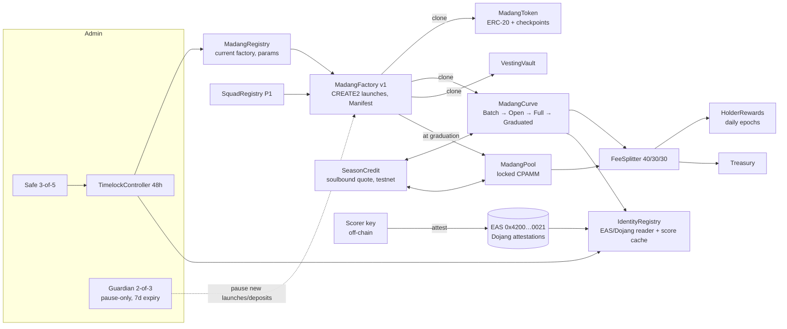

# 03 — Smart Contract Specification

Solidity ^0.8.26, EVM target `osaka` (GIWA Sepolia supports Osaka/Karst, 07 §1; set `evm_version = "cancun"` if the toolchain lags — no Osaka-only opcodes are required). Foundry project `contracts/`. All math is integer with the Pons-verified closed forms (02-contracts/formula-sheet.md). Nothing in the core is upgradeable (ADR-02).

## 1. Architecture



Contract count (P0): 11 deployed singletons/implementations + per-launch clones (token, curve, vault; pool at graduation).

| Contract | Kind | Mutability | Deployed by |
|---|---|---|---|
| `MadangRegistry` | singleton | timelock-controlled pointers | deployer (CREATE2) |
| `MadangFactory` | singleton per version | immutable code; config copied per launch | deployer (CREATE2) |
| `MadangToken` | EIP-1167 clone | immutable | factory |
| `MadangCurve` | EIP-1167 clone | immutable | factory |
| `VestingVault` | EIP-1167 clone | immutable | factory |
| `MadangPool` | EIP-1167 clone | immutable | factory (graduation) |
| `FeeSplitter` | singleton | immutable (per-launch split table) | deployer |
| `HolderRewards` | singleton | immutable | deployer |
| `IdentityRegistry` | singleton | timelock-controlled allow-lists | deployer |
| `SeasonCredit` | singleton (testnet) | timelock-controlled rations/seasons | deployer |
| `Treasury` | Safe | — | — |
| `TimelockController`, `Guardian` | OZ | — | deployer |
| `SquadRegistry`, `SquadVault` | P1 | | |

Design rule inherited from Pons and strengthened: **every per-launch parameter is copied into the clone at creation** (02 §2 shows Pons reads some values from the factory at runtime). Admin changes never touch a live launch (S4, S10).

## 2. Interfaces and state

### 2.1 `MadangRegistry`
```solidity
interface IMadangRegistry {
  function currentFactory() external view returns (address);
  function factoryOf(uint16 version) external view returns (address);
  function chainConfig() external view returns (ChainConfig memory); // quote, eas, attesters, schemas, weth
  event FactoryRegistered(uint16 version, address factory);
  event ChainConfigSet(bytes32 configHash);
}
```
State: `mapping(uint16 => address) factories; uint16 current; ChainConfig cfg;` Setters `onlyTimelock`. The frontend and keepers read `currentFactory()`; old factories keep serving their launches forever.

### 2.2 `MadangFactory`
```solidity
struct LaunchParams {            // chain/season defaults, copied into each launch
  address quote;                 // SeasonCredit (testnet) | WETH (mainnet)
  uint128 S;                     // 1e27 (1e9 tokens × 1e18)
  uint128 Q0;                    // virtual quote reserve
  uint128 G;                     // real-quote graduation threshold
  uint16  feeBps;                // 100
  uint16  creatorShareBps;       // 4000
  uint16  holdersShareBps;       // 3000  (protocol = remainder)
  uint32  obwDuration;           // 120 s
  uint32  humansFirst;           // 600 s
  uint16  capTier1Bps;           // 200  (of G)
  uint16  capTier2Bps;           // 500  (of G)
  uint16  peopleThreshold;       // 25
  uint32  graceFallback;         // 86400 s
  uint32  vestingDuration;       // 30 d
  uint32  vestingExpiry;         // 30 d
  uint16  maxCreatorAllocBps;    // 300 (of S)
  uint16  maxCreatorTaxBps;      // 300
  uint128 launchFee;             // quote units
}
struct Manifest {                // creator-chosen, immutable, emitted once
  uint16  version;               // manifest schema version
  address creator;
  uint16  creatorTaxBps;         // 0..300
  uint128 openingOrder;          // quote deposited into the window (may be 0)
  address[] teamWallets;         // ≤ 5, labels only, no privileges
  bytes32 metadataCID;           // IPFS CID (bytes32 digest form)
  uint64  squadId;               // 0 = none (P1)
}
interface IMadangFactory {
  function launch(Manifest calldata m, bytes32 salt) external returns (address token, address curve, address vault);
  function graduate(address token) external;                     // permissionless, bountied
  function predict(bytes32 salt, address creator) external view returns (address token, address curve);
  function launchParams() external view returns (LaunchParams memory);
  function launchOf(address token) external view returns (LaunchRecord memory); // curve, vault, pool, manifestHash, createdAt
  event Launched(address indexed token, address indexed curve, address vault, address indexed creator, bytes32 manifestHash, Manifest manifest, LaunchParams params);
  event Graduated(address indexed token, address pool, uint256 poolQuote, uint256 poolTokens, uint256 burned, address caller, uint256 bounty);
}
```
State: `LaunchParams params` (timelock-settable; applies to future launches), `mapping(address token => LaunchRecord)`, implementation addresses (immutable), `paused` (Guardian, expiring). `launch()` flow: validate manifest bounds → pull `launchFee + openingOrder` in quote → CREATE2-clone token, curve, vault with salt `keccak(creator, salt)` → `token.initialize(curve)` mints `S` to the curve → `curve.initialize(params, manifestHash, vault, creator)` → if `openingOrder > 0`, `curve.depositFor(vault, openingOrder)` (the creator's opening order is deposited in the window on behalf of the vault, so its tokens vest, S5) → emit `Launched`. Rate limits (F28, P1): `launchesToday[creator]` vs `IdentityRegistry.tierOf/scoreOf`.

### 2.3 `MadangToken`
ERC-20 (name, symbol, 18 decimals) + per-account `Checkpoints.Trace208` written on every balance change + `totalSupplyAt`. `initialize(address curve)` mints `S` once. No owner, no mint, no blacklist, no fee-on-transfer. Excluded-from-rewards set is held by `HolderRewards`, not by the token. `balanceOfAt(account, blockNumber)` is used by `HolderRewards` (S9).

### 2.4 `MadangCurve`
```solidity
enum State { Batch, Open, Full, Graduated }
interface IMadangCurve is IQuoteMarket {
  // window
  function deposit(uint256 amount, uint8 limitBucket) external;     // tier ≥ 1, cap by tier; bucket 0 = no limit, 1..7 = 1.1×…10× opening price (§3.2)
  function cancelDeposit() external;                                 // until obwEnd − 15 s
  function settle() external;                                        // anyone, after obwEnd; bounty
  function claimWindow(address account) external;                    // anyone can trigger, pays to account
  // trading (IQuoteMarket)
  function buy(uint256 quoteIn, uint256 minTokensOut, address to, uint256 deadline) external returns (uint256);
  function sell(uint256 tokensIn, uint256 minQuoteOut, address to, uint256 deadline) external returns (uint256);
  function quoteBuy(uint256 quoteIn) external view returns (uint256 tokensOut, uint256 fee, uint256 tax);
  function quoteSell(uint256 tokensIn) external view returns (uint256 quoteOut, uint256 fee, uint256 tax);
  // graduation
  function readyToGraduate() external view returns (bool);
  function graduate(address factory) external;                       // onlyFactory
  // views
  function state() external view returns (State);
  function reserves() external view returns (uint256 quoteReserve, uint256 tokenReserve, uint256 trackedQuote, uint256 sold);
  function attestedBuyers() external view returns (uint32);
  function fullSince() external view returns (uint64);
  event Deposited(address indexed account, uint256 amount, uint8 limitBucket, uint256 total);
  event DepositCancelled(address indexed account, uint256 amount);
  event Settled(uint256 deposits, uint256 filled, uint256 refunded, uint256 tokensAllocated, uint256 clearingPriceX96, uint32 participants, address caller);
  event WindowClaimed(address indexed account, uint256 tokens, uint256 refund);
  event Buy(address indexed account, address indexed to, uint256 quoteIn, uint256 fee, uint256 tax, uint256 tokensOut, uint256 priceAfterX96, bool firstAttested);
  event Sell(address indexed account, address indexed to, uint256 tokensIn, uint256 fee, uint256 tax, uint256 quoteOut, uint256 priceAfterX96);
  event StateChanged(State from, State to, uint64 at);
}
```
State: `params` (copied), `manifestHash`, `creator`, `vault`, `token`, `quote`, `openAt` (= createdAt), `obwEnd`, `state`, `trackedQuote`, `sold`, `deposits[addr]`, `limitBucket[addr]`, `depositsAtLimit[8]`, `totalDeposits`, `windowAllocation`, `windowFilledQuote`, `boughtInWindow[addr]`, `attestedBuyers`, `isCountedBuyer[addr]`, `fullSince`, `creatorTaxAccrued` (pushed to splitter), `feeAccrued`.

Eligibility: `_eligible(addr, amount)`: if `state == Batch` or `block.timestamp < obwEnd + humansFirst` → require `tier ≥ 1` and `boughtInWindow[addr] + amount ≤ cap(tier)`. Afterwards unrestricted.

Attested-buyer counting: on any buy or window fill, if `!isCountedBuyer[to] && tier(to) ≥ 1` → `attestedBuyers++`. (Counts the recipient, so routers cannot inflate; a tier-1 address counts once per curve.)

### 2.5 `VestingVault`
`initialize(token, beneficiary, curve)`; `vestedAt(t)`: 0 before `graduatedAt`; linear to `vestingDuration`; if `curve.state() != Graduated && t ≥ createdAt + vestingExpiry` → fully releasable. `release()` permissionless → beneficiary. Holds window claims (`curve.claimWindow(vault)` callable by anyone). Excluded from holder rewards.

### 2.6 `MadangPool`
```solidity
interface IMadangPool is IQuoteMarket {
  function initialize(address token, address quote, uint256 tokenAmount, uint256 quoteAmount, address splitter, SplitTable calldata split) external; // onlyFactory, once
  function getReserves() external view returns (uint256 tokenReserve, uint256 quoteReserve);
  function sync() external;                       // folds donations into reserves (k only grows)
  event Swap(address indexed sender, address indexed to, bool buy, uint256 amountIn, uint256 amountOut, uint256 fee, uint256 priceAfterX96);
}
```
No `mint/burn/removeLiquidity`; reserves can only change through swaps and `sync()`. Fee on the quote leg routed to `FeeSplitter` (M03). `skim` is intentionally absent.

Adapter seam (ADR-15, session 3): `MadangPool` implements `IGraduationTarget` — `initialize(...)` above is the adapter entry point — and the factory calls whichever graduation target its `LaunchParams` names (v1: the pool implementation). If a canonical DEX reaches GIWA mainnet (OQ-7.3 / OQ-9.2), a DEX adapter (for example Uniswap v4 with a fee-routing hook) is registered through a new factory version; the window and curve code never reference the pool type. Cost today: one interface and one indirection.

### 2.7 `FeeSplitter`
`accrue(token, amount, Kind)` callable only by registered curves/pools (registered by the factory at creation); `claimCreator(token, to)` by the launch creator; `pushHolders(token)` by anyone (moves `holdersAccrued[token]` into `HolderRewards.fund(token, amount)` and pays `bountyBps` of it to caller); `claimProtocol(to)` by Treasury. Split tables per token copied at registration. Invariant: `quote.balanceOf(this) == Σ accrued − Σ claimed`.

### 2.8 `HolderRewards`
`fund(token, amount)` (from splitter); epochs of `EPOCH = 1 day` since `startOf[token]`; `finalizeEpoch(token)` (anyone, bounty) fixes `snapshotBlock = epochEnd − (prevrandao % 3600 / blockTime)` within the last hour and `eligibleSupply = totalSupplyAt(snapshot) − Σ excluded.balanceOfAt(snapshot)`; `claim(token, epochs[])` pays `funded[e] · balanceOfAt(user, snap_e) / eligible_e`; unclaimed after 180 days rolls into the next epoch via `recycle(e)`. Excluded set: curve, pool, vault, `0xdead`, splitter, this.

Session 3 audit note (ADR-16, **proposed**): on OP Stack chains `block.prevrandao` is the L1 RANDAO of the current L1 origin — constant across many L2 blocks and knowable minutes ahead — so the snapshot block above is predictable, and only the 2% round-trip fee (04-security §1.3) deters snapshot farming. Proposed replacement: pay `funded_e · twab_user / twab_eligible`, where `twab` is the time-weighted average balance over the epoch computed from the token's existing checkpoints; there is then no snapshot block to game, and a one-hour hold earns 1/24 of a day's share. Needs owner approval before F10 is built (W4–W5).

### 2.9 `IdentityRegistry`
```solidity
interface IIdentityRegistry {
  function register(bytes32 attestationUID) external;          // verifies against EAS, caches tier+expiry
  function refresh(address account) external;                  // re-validate / downgrade on revocation
  function tierOf(address) external view returns (uint8);      // 0,1,2
  function scoreOf(address) external view returns (uint8, uint32 season); // from MadangCreatorScore attestations
  function setAttester(address attester, uint8 tier, bool allowed) external;   // onlyTimelock
  function setSchema(bytes32 schemaUID, Kind kind, bool allowed) external;      // onlyTimelock
  event TierUpdated(address indexed account, uint8 tier, uint64 expiry, bytes32 uid);
}
```
Reads `IEAS(0x4200000000000000000000000000000000000021).getAttestation(uid)` [ONCHAIN 07 §2] and checks `schema` ∈ allowed Dojang `VerifiedAddress` schema(s), `attester` ∈ allowed (Upbit → tier 2, GIWA faucet → tier 1), `recipient == msg.sender` (or `account` for `refresh`), `revocationTime == 0`, `expirationTime == 0 || > now`. UP ID bonus (tier 1 → 2 when an UP ID name resolves to the address) is P1 after the UP ID registry interface is confirmed (07 OQ). Score attestations: our schema `MadangCreatorScore(address creator, uint8 score, uint32 season, bytes32 methodHash)` issued by the allow-listed `Scorer`.

### 2.10 `SeasonCredit` (testnet quote)
ERC-20 "Season Credit" (`SC`, 18 dec). `transfer/transferFrom` require `isMarket[from] || isMarket[to]` (curves, pools, splitter, vaults, HolderRewards; registered by the factory). `claimDaily()`: `ration[tier] × min(daysSinceLastClaim, 7)`; `season()`; `burnExpired(address[])` permissionless after `seasonEnd` (burns balances minted in prior seasons — implemented by season-tagged balances: `balanceBySeason[addr][season]`, with spends drawing from the oldest season first). `setSeason(start, end, rations)` onlyTimelock. On mainnet this contract is simply not referenced (quote = WETH).

### 2.11 `IQuoteMarket` (shared by curve and pool)
`buy/sell/quoteBuy/quoteSell/token/quote/priceX96()` — one frontend trade path before and after graduation.

## 3. Curve, fee and graduation math (worked examples)

Parameters (testnet defaults): `S = 1e9 tokens`, `Q0 = 1,000 SC`, `G = 2,500 SC`, `f = 1%`, creator tax `c ∈ [0, 3%]`.

Definitions: `quoteReserve = Q0 + trackedQuote`, `tokenReserve = S − sold`, `k = quoteReserve · tokenReserve` (constant across trades; fees are removed before the swap), spot price `p = quoteReserve / tokenReserve`.

Derived constants (02 §6 identities with our parameters):
- Initial price `1,000 / 1e9 = 1.0e-6 SC/token`; initial FDV `= Q0 = 1,000 SC`.
- Token reserve when full: `S·Q0/(Q0+G) = 1e9 · 1000/3500 = 285,714,285.71` → sold on curve `714,285,714.29` (71.43%).
- Price when full: `3,500 / 285,714,285.71 = 1.225e-5 SC/token`; FDV at graduation `Q0·(1+G/Q0)² = 1,000 · 3.5² = 12,250 SC` (Pons: 1.68·3.5² = 20.58 ETH ✓ same form).
- Pool seed: `poolQuote = G = 2,500 SC`; `poolTokens = S·Q0·G/(Q0+G)² = 204,081,632.65` (20.41%); seed price `2,500/204,081,632.65 = 1.225e-5` ✓ continuity.
- Burned remainder: `S·Q0²/(Q0+G)² = 81,632,653.06` (8.16%) (ADR-07).
- Gross quote needed to graduate: `G/(1−f−c)`: 2,525.25 SC (c = 0), 2,551.02 SC (c = 1%), 2,604.17 SC (c = 3%).

### 3.1 Buy (Open state)
```
fee  = quoteIn · f / 1e4
tax  = quoteIn · c / 1e4
net  = quoteIn − fee − tax
tokensOut = net · tokenReserve / (quoteReserve + net)
partial fill: if tokensOut > sellable (= tokenReserve − S·Q0/(Q0+G)) then
   tokensOut = sellable; net' = ceil(quoteReserve · sellable / (tokenReserve − sellable)); gross' = ceil(net' · 1e4 / (1e4 − f − c)); refund quoteIn − gross'
trackedQuote += net; sold += tokensOut; accrue(fee → split, tax → creator)
```
Example A — single buy of 50 SC right after a window that left `quoteReserve = 1,297`, `tokenReserve = 771,010,000`: fee 0.5, tax 0, net 49.5 → `tokensOut = 49.5 · 771,010,000 / 1,346.5 = 28,344,000.4` tokens; price after `1,346.5 / 742,666,000 = 1.813e-6`.

### 3.2 Opening window settlement
All committed deposits `D` are treated as one buy with `fee = D·f/1e4`, `tax = D·c/1e4` (the tax also applies to the creator's own opening order — simpler, and disclosed on the card).

Limit-price rule (v1, deliberately simple and O(1)): a limit is chosen from 8 fixed buckets expressed as multiples of the opening price (`1.1×, 1.25×, 1.5×, 2×, 3×, 5×, 10×, none`); deposits accumulate per bucket (`depositsAtLimit[b]`). At settlement: compute the clearing price `P₁` with every deposit; every bucket whose limit is below `P₁` is excluded and refunded in full; the window clears once more with the remaining deposits at `P₂ ≤ P₁`. Because removing deposits only lowers the price, no remaining bucket becomes ineligible, so exactly two computations over 8 buckets suffice. Excluded depositors who would have accepted `P₂` are still refunded — an accepted trade-off for deterministic settlement. `claimWindow` refunds if the depositor's bucket was excluded, otherwise fills pro-rata at `P₂`. Deposits without a limit are always included.

Example B — `D = 300 SC` (12 depositors), c = 0: fee 3, net 297 → `T = 297 · 1e9 / 1,297 = 228,990,000` tokens (22.9% of supply); clearing price `297/228,990,000 = 1.297e-6 SC/token`; a 25 SC depositor receives `228,990,000 · 25/300 = 19,082,500` tokens. State after: `quoteReserve = 1,297`, `tokenReserve = 771,010,000` (Example A continues from here).

Example C — a 25-person tier-2 window at the 125 SC cap: `D = 3,125 > gross-needed 2,525.25` → partial fill: `filled = 2,525.25`, refund `599.75` pro-rata (19.19% of each deposit), `T = 714,285,714.29` (all sellable), `attestedBuyers = 25 ≥ N` → `graduate()` is immediately callable: 25 real people graduated a token at one price. This is the designed best case.

### 3.3 Sell
```
grossOut = quoteReserve · tokensIn / (tokenReserve + tokensIn)
fee = grossOut·f/1e4 ; tax = grossOut·c/1e4 ; quoteOut = grossOut − fee − tax
trackedQuote −= grossOut ; sold −= tokensIn ; accrue
allowed in Open and Full (unlike Pons, 02 §4) — never in Batch or Graduated
```
Example D — sell 10,000,000 tokens at `quoteReserve = 1,346.5`, `tokenReserve = 742,666,000`: `grossOut = 1,346.5 · 1e7 / 752,666,000 = 17.889 SC`; fee 0.1789; out 17.710 SC. If `trackedQuote` drops below `G` while `Full`, state returns to `Open` and `fullSince` resets.

### 3.4 Graduation
```
readyToGraduate = state ∈ {Full} && (attestedBuyers ≥ N || now ≥ fullSince + graceFallback)
graduate: push accrued fees; move trackedQuote (= G) and tokenReserve to factory;
          poolTokens = tokenReserve · G/(Q0+G); burn tokenReserve − poolTokens;
          pool.initialize(token, quote, poolTokens, G); pay bounty from protocol share; state = Graduated
```
Bounty: `min(bountyCap, G · 5 bps)` = 1.25 SC on testnet defaults, paid from the protocol fee accrued for this token (never from pool liquidity).

### 3.5 Pool swaps (post-graduation)
Buy: `net = quoteIn·(1−f)`, `tokensOut = R_t·net/(R_q+net)`; sell: `gross = R_q·tokensIn/(R_t+tokensIn)`, `quoteOut = gross·(1−f)`; fee → splitter. Example E — day of 400 SC buys and 300 SC gross sells → fees 7 SC → creator 2.8 / holders 2.1 / protocol 2.1; a holder with 5% of eligible supply at the epoch snapshot claims 0.105 SC for that epoch.

### 3.6 Parameter table

| Param | Testnet default | Mainnet proposal | Bounds (contract) | Rationale |
|---|---|---|---|---|
| `S` | 1e9 tokens | 1e9 | fixed | industry norm; Pons [ONCHAIN] |
| `Q0` | 1,000 SC | 1.0 ETH | > 0 | ration-scaled; mainnet ≈ Pons 1.68 scaled down for a new chain |
| `G` | 2,500 SC | 2.5 ETH | `G/Q0 ∈ [1.5, 4]` | keeps 71/20/8 split near Pons' verified 2.5 ratio |
| `feeBps` | 100 | 100 | ≤ 200 | Pons 1% [ONCHAIN]; pump.fun 1.25% [WEB] |
| split creator/holders/protocol | 40/30/30 | 40/30/30 (or 55/0/45 if counsel requires, 12 §5) | creator ∈ [30, 70]; holders ∈ {0} ∪ [20, 40]; protocol ≤ 45 (ADR-17) | M07 |
| `obwDuration` | 120 s (A/B 90/180) | 120 s | 60–600 | S1 |
| `humansFirst` | 600 s | 600 s | 0–3600 | S2 |
| caps tier1/tier2 | 2% / 5% of `G` | same | ≤ 10% | S2 |
| `peopleThreshold N` | 25 | 50 (revisit) | 5–500 | S3 |
| `graceFallback` | 24 h | 24 h | 1–72 h | S3 |
| creator alloc max | 3% of S | 3% | ≤ 5% | S5; Pons has no cap |
| creator tax max | 3% | 3% | ≤ 3% | M09 (Pons 10%) |
| vesting | cliff grad, 30 d linear, 30 d expiry | same | 7–90 d | S5 |
| launch fee | 1 SC | 0.0005 ETH | — | Pons 0.0005 ETH [ONCHAIN] |
| rations tier0/1/2 | 0 / 20 / 50 SC per day | n/a | — | S12 |
| epoch | 1 day | 1 day | — | S9 |
| bounties | 5 bps of moved amount, caps | same | — | I28 |

## 4. Access control

| Role | Holder | Powers | Cannot |
|---|---|---|---|
| Timelock (48 h) | Safe 3-of-5 proposer/executor | set `LaunchParams` for future launches, attesters/schemas, scorer, season/rations, register new factory version, bounty sizes, Guardian membership | touch any live curve/pool/vault/splitter balance; change a live launch's parameters |
| Guardian | 2-of-3, pause-only | `pauseNewLaunches()`, `pauseDeposits()` — each auto-expires after 7 days | pause sells, claims, `settle`, `graduate`, `release`; move funds |
| Factory | contract | create clones, initialise pool at graduation, register markets with splitter/credit | anything after initialisation |
| Scorer | KMS key | issue/revoke `MadangCreatorScore` attestations | affect funds; scores only gate limits/perks |
| Creator | EOA/AA | choose manifest at launch, claim fees, receive vesting | sell vault tokens early, change manifest, exempt anyone |
| Anyone | — | `settle`, `graduate`, `claimWindow(for)`, `release`, `pushHolders`, `finalizeEpoch`, `refresh`, `burnExpired` | — |

No `onlyOwner` EOAs anywhere (Pons: `feeSweepOperator` hot EOA, 04 §3).

## 5. ADR-02 — Upgradeability: immutable core + versioned factory

Decision: no proxies in token, curve, pool, vault, splitter, rewards. Behaviour changes ship as `MadangFactory v2` registered in `MadangRegistry` via the timelock; old launches keep old code. `IdentityRegistry` and `SeasonCredit` have timelocked parameters but immutable code; if their logic must change, a new instance is registered and the factory's `LaunchParams` points at it for new launches.

Rationale: (1) The product's promise is "rules you can read before you buy" (S4); a proxy makes that promise conditional on admin behaviour. (2) Pons itself iterated through three generations without proxies [ONCHAIN 02 §8], proving the pattern is operationally fine for a launchpad. (3) Audit scope stays per-version and small. Cost: bug fixes cannot patch live launches — mitigated by the Guardian pause on *new* activity, the small size of the core (~1,200 lines), and the test plan (04-security). Consequence: the frontend must handle multiple factory versions (registry-driven).

## 6. Emergency controls

- Guardian pauses (new launches, new window deposits) with 7-day expiry; renewing requires the timelock.
- Nothing can freeze a user's exit: `sell` (curve Open/Full and pool), `claimWindow`, `release`, `claim` are never pausable.
- `graduate()` has no pause; if the pool implementation were found faulty before any graduation, the timelock can register a new factory and the Guardian pauses launches on the old one; existing Full curves can still graduate on the old pool code (documented risk) — or, if `graceFallback` has not elapsed, holders can sell.
- `rescueERC20` exists only on the factory for tokens mistakenly sent to it (never quote belonging to launches; never on curves/pools).
- Kill switch for `SeasonCredit` minting (`claimDaily` pause) exists because it is testnet-only.

## 7. Deterministic deployment and chain configuration

- All singletons deployed through **CreateX** (`0xba5Ed099…`, present on GIWA Sepolia [ONCHAIN 07 §2]) with `salt = keccak256("madang.v1.<Name>")` guarded by the deployer address (CreateX's redeploy-protection salt format), **no constructor args** except immutable implementation addresses that are themselves deterministic. Chain-specific values live in `MadangRegistry.chainConfig` (quote, WETH `0x4200…0006`, EAS `0x4200…0021`, attesters, schema UIDs, timelock, treasury), set once by the deployer in the same script, then ownership handed to the timelock. Result: identical core addresses on GIWA Sepolia and GIWA mainnet given the same deployer key and bytecode (AC-C8).
- Per-launch clones use `salt = keccak256(creator, userSalt)` so vanity/predicted addresses are possible and `predict()` works for the UI before the tx.
- Config is a JSON per chain (`deploy/config/giwa-sepolia.json`, `giwa-mainnet.json`) hashed into `ChainConfigSet(configHash)` for auditability.
- Verification: Sourcify + Blockscout API v2 (07 §4), standard-json, run in CI.

## 8. Pons weaknesses / attacks → mitigations

| # | Pons weakness or attack (evidence) | Madang mitigation | Where |
|---|---|---|---|
| 1 | Launch+buy+graduate bundle in one tx; 100% of sampled graduations (05 §3) | Batch window: no trades at all for 120 s; creator opening order clears with everyone | §2.4, S1 |
| 2 | Snipe-tax exemptions invisible to users (02 §3, 03 §6) | No exemptions exist; manifest hashed and rendered; team wallets are labels only | §2.2, S4 |
| 3 | Single-whale graduation (05 §3) | People threshold `N` + caps in humans-first time + 24 h fallback with sells open | §2.4, §3.4, S3 |
| 4 | Creator curve dumps: 48% of deployers sell (05 §5) | Opening allocation only via vesting vault; cliff at graduation | §2.5, S5 |
| 5 | Volume-churn trending (05 §5) | Off-chain, but the chain provides `firstAttested` flags and buyer counts for quality ranking | §2.4 events, S8 |
| 6 | Hot-EOA `feeSweepOperator`, scheduled holder payouts (04 §3) | Pull-based splitter; permissionless bountied `pushHolders`, `finalizeEpoch` | §2.7–2.8, S6 |
| 7 | Buyback slice executable by keeper with price impact (02 §5) | Dropped | M10 |
| 8 | Runtime reads of factory config affecting live curves (02 §2) | Params copied into clones at creation | §1 rule |
| 9 | 2-of-3 Safe owner, no timelock (02 incidents) | 3-of-5 Safe → 48 h timelock; Guardian pause-only with expiry; in-app notice | §4, S10 |
| 10 | v4 hook captures 100% of LP fee, complex surface (02 §7) | Own ~150-line CPAMM; fee on quote leg; no hooks | §2.6 |
| 11 | Graduate-and-forget (02 §7) | Holder epochs funded by 30% of pool fees forever | §2.8, S9 |
| 12 | Indexer outage read as chain halt (04 §5) | Contracts expose everything the trade UI needs via views (`quoteBuy`, `reserves`, `state`); no dependency on an indexer for trading | §2.4, §2.11 |
| 13 | Spam launches from 25 addresses > 1,000 launches each (05 §4) | Rate limits by tier/score (P1); tier-0 cannot deposit in windows; launch fee in rationed SC on testnet | §2.2, F28, S12 |
| 14 | Admin-settable max creator tax 10% (02 §1) | Hard cap 3% in code | §2.2 bounds |
| 15 | Donations to curve swept at graduation ("anything donated… swept", 02 §6) | `trackedQuote` only; surplus quote is forwarded to the holder-rewards epoch of that token, surplus tokens burned | §3.4 |
| 16 | Sell disabled when curve is full (02 §4) — traps holders behind a whale | Sells allowed in `Full` | §3.3 |
| 17 | Sandwich/ordering on sub-second blocks (07 §1 inferred) | Window clears at one price; slippage+deadline on all trades; per-block uniform pricing as P2 (I05) | §3.2, F35 |

## 9. Gas and size notes
- All clones are EIP-1167 (≤ 24 KB implementation limit irrelevant; GIWA has the standard 24,576-byte contract-size limit, 07 §1). `MadangCurve` is the largest implementation (~9–11 KB estimated).
- Per-tx gas cap on GIWA is 16,777,216 (07 §1): `launch()` (3 clones + init) ≈ 600–800k gas; `settle()` O(1); `claimWindow` per user; `finalizeEpoch` O(excluded set ≤ 6). Nothing approaches the cap.
- Checkpointed transfers ≈ +20k gas; immaterial on GIWA (free gas) and acceptable on mainnet.

## 10. Repository layout
```
contracts/
  src/{MadangRegistry,MadangFactory,MadangToken,MadangCurve,VestingVault,MadangPool,FeeSplitter,HolderRewards,IdentityRegistry,SeasonCredit}.sol
  src/interfaces/*.sol   src/libraries/{CurveMath,WindowMath,Split}.sol
  test/unit  test/fuzz  test/invariant  test/fork  test/differential (python replay harness from 02-contracts/verification)
  script/{Deploy.s.sol,Configure.s.sol,Verify.s.sol}  deploy/config/{giwa-sepolia,giwa-mainnet}.json
```
