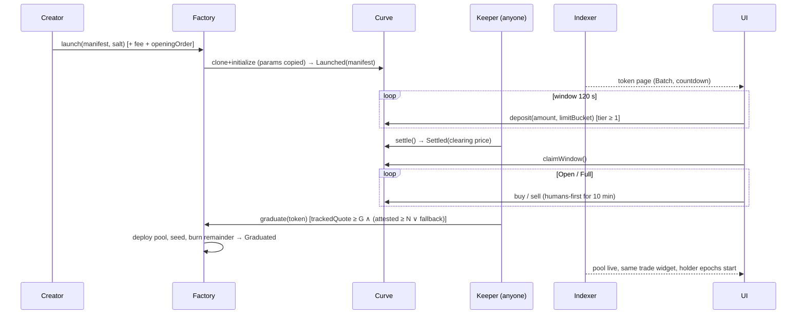

# 05 — System Architecture

Design principles (from 04-backend-infra lessons): the chain is the source of truth for trading; the indexer is for lists and analytics; every keeper function is permissionless; every external dependency has a failover; health is reported per layer.

## 1. Component diagram

```mermaid
flowchart TB
  subgraph Client["Client (Next.js 16 App Router, PWA)"]
    UI[UI / i18n KO·EN]
    WAG[wagmi + viem<br/>external + embedded wallet]
    SWR[SWR cache + SSE client]
  end
  subgraph Edge["Vercel"]
    RSC[RSC pages / Route Handlers]
    API[/api: lists, token, profile, points, status/]
    RPCP[/api/rpc proxy<br/>failover: official → QuickNode → Nodit/]
    SSE[/api/stream SSE fan-out/]
    IMG[/api/media: upload → safety → resize → Blob + IPFS pin/]
  end
  subgraph Data["Data plane"]
    IDX[Indexer: Ponder<br/>(events → Postgres)]
    PG[(Neon Postgres<br/>+ LISTEN/NOTIFY)]
    SCORE[Scoring job<br/>daily: reputation, points, clusters]
    KEEP[Keepers ×2 regions<br/>settle · graduate · finalizeEpoch · push]
    BLOB[(Vercel Blob)]
    IPFS[(Pinata / web3.storage)]
  end
  subgraph Chain["GIWA (Sepolia → mainnet)"]
    RPC1[sepolia-rpc.giwa.io]
    RPC2[QuickNode]
    RPC3[Nodit RPC + Webhook/Stream]
    FB[flashblocks RPC]
    BS[Blockscout API v2]
    EAS[(EAS / Dojang)]
  end
  UI --> RSC --> API --> PG
  WAG --> RPCP --> RPC1 & RPC2 & RPC3
  WAG -. quotes .-> FB
  SWR --> SSE --> PG
  IDX --> RPC1 & RPC2
  IDX --> PG
  SCORE --> PG
  SCORE -->|EAS attest| EAS
  KEEP --> RPC1 & RPC2
  IMG --> BLOB & IPFS
  API -. fallback metadata .-> BS
```

## 2. Frontend
- Next.js 16 (App Router, RSC for lists/SEO, client components for trade widgets), Tailwind v4, shadcn/ui, wagmi v2 + viem with a custom GIWA chain definition (`id 91342`, RPC, explorer; 07 §1) and the flashblocks RPC as an optional transport for `pending` quotes.
- Wallets: injected/WalletConnect + embedded wallet (social login; **provider decision open**: Privy/Turnkey/Web3Auth; Kakao login support is the selection criterion, 13-decision-log).
- Data fetching: RSC for first paint, SWR for client state, SSE (`/api/stream`) for realtime invalidation (Pons uses Ably, 04 §2; we start with SSE from Postgres `LISTEN/NOTIFY` and keep Ably as a drop-in if fan-out exceeds Vercel function limits).
- Trading never depends on the API: quotes via `quoteBuy/quoteSell` multicall (Multicall3 at the canonical address, 07 §2), state via `reserves()/state()`, simulation via `eth_simulateV1` if supported (test in Phase 0; fallback `eth_call` + `estimateGas`).
- PWA: installable, push notifications (web push) for alerts (P1).

## 3. Indexer
- **Ponder** (TypeScript, Postgres, GraphQL/HTTP) with `MadangFactory` as the root contract and child-contract factories for curves/pools/vaults via `Launched`/`Graduated` events (07 §4: Ponder works on any EVM RPC; Goldsky/Subsquid are alternatives if GIWA adds first-class support).
- Tables: `launches`, `manifests`, `curve_states`, `window_deposits`, `trades`, `holders` (balances + first-buy block), `graduations`, `pools`, `fee_accruals`, `epochs`, `claims`, `identities` (tier/expiry), `scores`, `season_points` (provisional/final), `squads` (P1), `timelock_ops`, `guardian_pauses`.
- Derived: sell-back ratio, distinct attested buyers, holder retention cohorts, cluster labels (scoring job writes back), ranking scores (materialised every 10 s).
- Reorg handling: 2-block confirmation buffer for derived tables; raw events stored at `latest` and marked `finalized` after safe head.
- Fallback source: Nodit Webhook/Stream for event push and Blockscout API v2 for backfills (07 §4); if Ponder lags > 5 blocks → indexer-health yellow.

## 4. API (Route Handlers)
`GET /api/launches?feed=rising|new|graduating|graduated&cursor` · `GET /api/launches/:token` (manifest, state, counts, labels) · `GET /api/launches/:token/trades|holders|window` · `GET /api/profile/:address` (tier, score, badges, launches, positions) · `GET /api/points/me|leaderboard|method` · `GET /api/squads/*` (P1) · `GET /api/status` (chain, indexer, keepers, pending timelock ops) · `POST /api/media` (upload) · `POST /api/session` (SIWE) · `POST /api/legal/acceptance` · `POST /api/alerts` (P1) · `POST /api/rpc` (JSON-RPC proxy, allow-listed methods, per-IP limits). Caching: edge cache 2–5 s for lists, `stale-while-revalidate`; token pages RSC-rendered with 1 s revalidate.

## 5. Realtime layer
Postgres `NOTIFY` on insert into `trades`, `curve_states`, `graduations`, `epochs`, `timelock_ops` → `/api/stream` SSE per topic (`token:<addr>`, `feed`, `status`) → SWR `mutate`. Latency target: UI update ≤ 1 s after block. Scaling: SSE connections are cheap; if > 5k concurrent, move to Ably/Pusher (adapter interface kept thin).

## 6. Storage
- Postgres (Neon): indexer + app tables (profiles, media refs, ToS acceptances, alert subscriptions, experiment assignments). Daily branch snapshot; PITR 7 days.
- Vercel Blob (private, signed URLs) for original uploads; derived sizes public via image proxy; IPFS pin (Pinata) for the metadata JSON + image so `metadataCID` in the manifest is resolvable without us.
- No PII beyond wallet addresses, optional display names, and hashed IPs for rate limits (10-legal).

## 7. Image and metadata pipeline
1. Client uploads (≤ 5 MB, PNG/JPG/WebP/GIF) → `/api/media` → magic-byte check → re-encode → **safety checks**: perceptual-hash match against a block list (idol photos, logos, prior takedowns), vision-model NSFW/violence/impersonation classifier (score + human review queue), OCR for stock tickers/brand names on the block list → 512/128/64 px variants → Blob + IPFS pin → returns `metadataCID`.
2. Metadata JSON `{name, symbol, description_ko, description_en, image, links, version}` pinned; the manifest stores the CID digest.
3. Post-publish: report button → moderation queue → takedown flips a `hidden` flag (chain data unaffected; the token is still tradeable via chain path but delisted from feeds) → transparency log.

## 8. Keepers / bots
- Stateless Node workers (2 regions: Seoul + Singapore) polling confirmed heads: `settle()` for windows whose `obwEnd` passed, `graduate()` where `readyToGraduate()`, `finalizeEpoch()` daily, `pushHolders()` when accrued ≥ threshold, `refresh()` for identities with expiring attestations, `burnExpired()` at season end.
- Bounties make all of these profitable for third parties (I28); we publish a `keeper-kit` so others can run them — our bots being down must not matter (AC-O1).
- Keeper wallets hold minimal funds and no roles; alerts on failure or SLA breach (04-security §6).

## 9. Scoring job (reputation, points, clusters)
- Daily batch (and hourly provisional for the UI) in a worker: reads Postgres → computes creator sub-scores, season points by category, cluster detection (same-funder graphs from first-funding txs via Blockscout API, timing correlation, circular trade detection) → writes `scores`/`season_points` → issues/revokes `MadangCreatorScore` attestations via the KMS-held Scorer key → publishes `methodHash` and the method doc version.
- Season end: provisional → 7-day review → final → `MadangSeasonBadge` attestations.

## 10. Infra, hosting, observability
- Vercel (app, API, SSE, media) · Neon (Postgres) · Fly.io or Railway (Ponder indexer, keepers, scoring job; 2 regions) · Vercel Blob · Pinata · QuickNode + Nodit (RPC/data) + official RPC · Cloudflare Turnstile · Sentry · Axiom or Grafana Cloud · Better Stack (status page) · GitHub Actions (CI: forge tests, Playwright, Slither, deploy).
- Logs are structured JSON with `chainHead`, `indexerHead`, `requestId`; traces for RPC proxy and SSE.

## 11. Resilience (Pons infra incident applied, 04 §5)
- Health model with three independent indicators — **chain** (RPC head age, provider agreement), **indexer** (head lag), **app** (error rate) — shown on the status page and as banners; trade widget enabled whenever chain is green regardless of indexer.
- RPC: three providers, health-scored round-robin with circuit breakers; client gets the proxy URL only (keys server-side); reads with `latest` fall back across providers; `eth_sendRawTransaction` fans out to all healthy providers.
- Indexer: two Ponder instances (primary + warm standby reading the same chain, separate DBs) with a routing flag; backfill from Blockscout/Nodit on gaps.
- Keepers: two regions + public bounties.
- Database: Neon autoscaling + read replica for the API; connection pooling.
- Incident comms templates in KO/EN; status page sources every claim ("indexer delayed; chain producing blocks at 1 s").

## 12. Cost estimates (monthly, USD)

| Item | Testnet (Seasons 0–2) | Mainnet year 1 |
|---|---|---|
| Vercel Pro + usage | 20–150 | 150–600 |
| Neon Postgres | 19–69 | 69–300 |
| Indexer + keepers hosting (Fly/Railway, 2 regions) | 40–120 | 120–400 |
| RPC (QuickNode + Nodit; official is free) | 0–300 | 300–1,500 |
| Blob + Pinata | 10–40 | 40–200 |
| Sentry + logs + status page | 30–80 | 80–300 |
| Turnstile, email/Telegram bots | 0–20 | 20–100 |
| Vision/safety model API | 20–100 | 100–500 |
| **Total** | **~140–880** | **~880–3,900** |

Not included: audits ($25–90k, 04 §4), bug bounty reserve, legal, marketing.

## 13. Scaling plan
- Reads: edge caching + RSC; token pages ISR 1 s; lists materialised in Postgres.
- Writes: on-chain; API writes are low volume (media, profile).
- Indexer: Ponder handles thousands of events/s on a modest instance; GIWA throughput (free gas, 1-s blocks) could produce Pons-like 36k launches/day = 0.4/s — trivial; trades at 100/s would still be fine. Partition `trades` by month when > 50M rows.
- Realtime: SSE → Ably if > 5k concurrent.
- Scoring: daily batch scales linearly; cluster detection on funding graphs limited to active wallets of the season (< 1M nodes) — fits in Postgres + in-memory graph.
- Mainnet: same topology; add a read replica, a second indexer region, and paid RPC tiers.

## 14. Sequence — launch to graduation


