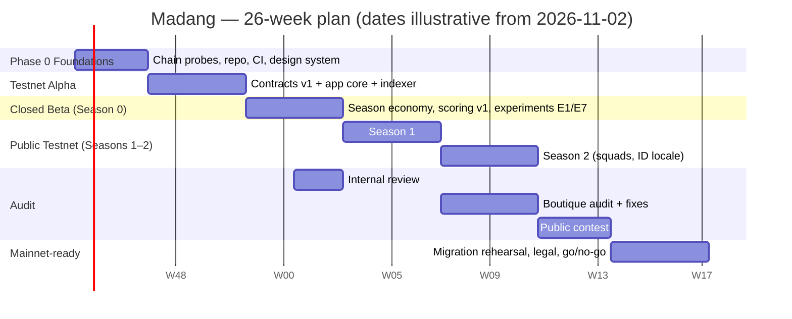

# 11 — Roadmap

26 weeks from kickoff to mainnet-ready, assuming a core team of 4 (see §5); the lean 1–3 builder variant is in §6. Weeks are calendar weeks from kickoff (W1). Phase names match the brief: Phase 0 foundations → testnet alpha → closed beta → public testnet → audit → mainnet-ready.

## 1. Phase overview

## 2. Week-level milestones

### Phase 0 — Foundations (W1–W3)
- W1: Repo + CI (forge, slither, Playwright); GIWA chain probes: `eth_simulateV1` support, flashblocks RPC behaviour, EAS Dojang attestation reads on a fork with real UIDs (faucet + Upbit), count of Verified Address attestations (R2); CreateX deployment dry-run; Ponder hello-world on GIWA Sepolia.
- W2: Contract skeletons + `CurveMath/WindowMath` libraries with differential tests against the Phase 2 Python replay; design system (tokens, Pretendard, Madang ring); i18n scaffold with KO/EN terminology sheet; counsel engagement started (Q1–Q4, Q8, Q11).
- W3: `IdentityRegistry` against real attestations on fork; `SeasonCredit`; deploy script with config JSON; status page skeleton (chain/indexer/app). **Exit**: all Phase 0 unknowns resolved or re-planned; ADRs updated.

### Testnet Alpha (W4–W7)
- W4: `MadangFactory`, `MadangToken`, `MadangCurve` (Batch/Open/Full) with unit + fuzz tests; app: wallet, verify flow, home feed (New).
- W5: `VestingVault`, `FeeSplitter`, `HolderRewards`, `MadangPool`, graduation path; invariant suite v1; app: token page states, trade widget with simulation + error glossary.
- W6: Create flow (3 steps) + media pipeline with safety checks; indexer tables + SSE; keepers v1 (2 regions); Fairness Card everywhere.
- W7: Deploy v1 to GIWA Sepolia (CREATE2), Blockscout/Sourcify verification; private alpha with 15–30 creators; Playwright e2e KO/EN. **Exit**: AC-C1…C8, AC-A1…A3 pass; alpha metrics (09-gtm §1) met; no SEV1.

### Closed Beta — Season 0 (W8–W11)
- W8: Points v1 + scoring job + method page; portfolio/claims; creator dashboard; experiment assignment (E1, E7, E8).
- W9: Governance page (timelock ops), Guardian, in-app pending-change banner; Safe + timelock live on Sepolia; ops charter published.
- W10: Internal security review (checklist, invariants mapping) begins; chaos tests (indexer off, RPC failover); load tests; status page public.
- W11: Season 0 settlement dry-run (provisional → review → final badges); Fairness Report #0. **Exit**: Season 0 exit metrics; AC-O1…O4 demonstrated; internal review findings fixed.

### Public Testnet — Season 1 (W12–W15)
- W12: Public launch week (09-gtm §6); First 100 creators; Telegram/Kakao bots (manual → automated alerts P1).
- W13: Rate limits by tier/score (F28); watchlists + alerts (F27); experiments E2/E3/E4 live.
- W14: Sunrise scheduled launches (F30); early-holder bonus epoch (F29); keeper-kit release.
- W15: Season 1 settlement; recap with experiment results; parameter decisions for Season 2. **Exit**: Season 1 metrics; third-party keepers ≥ 30%.

### Public Testnet — Season 2 (W16–W19) ∥ Audit begins
- W16: Squads (F25) + squad pages/leaderboards; Bahasa Indonesia locale (F32); boutique audit kicks off on a frozen tag.
- W17: Retro cluster slashing v2 with appeals (F26); squad battles (F31).
- W18: Audit fixes; differential checks nightly; mainnet config JSON drafted.
- W19: Season 2 settlement + recap. **Exit**: Season 2 metrics; audit report received.

### Audit & Contest (W16–W22)
- W16–W19 boutique audit (overlaps Season 2); W20–W22 public contest on the fixed code; fixes + re-review; publish reports in-app.

### Mainnet-ready (W23–W26)
- W23: Mainnet migration rehearsal on a fresh Sepolia deployment with mainnet config (12-migration §4); legal opinions in; name/trademark final.
- W24: Bug bounty on Immunefi (mainnet scope); ops drills (signer, incident); monitoring dashboards hardened.
- W25: Season 3 on testnet continues (keeps community warm); mainnet go/no-go checklist review.
- W26: **Go/no-go**. If GIWA mainnet is not live, continue seasons and hold mainnet-ready state (R12).

## 3. Exit criteria per phase (summary)

| Phase | Exit criteria |
|---|---|
| Foundations | chain unknowns resolved; differential harness green; design system + i18n scaffold; counsel engaged |
| Alpha | contract ACs pass; 20 launches/5 graduations with ≥ 15 attested buyers; SUS ≥ 70; verified on Blockscout |
| Season 0 | ≥ 100 launches; grad rate ≥ 5%; D7 ≥ 35%; keepers SLA; zero SEV1; internal review fixed |
| Season 1 | 3,000 tier-1 / 800 tier-2 users; north star ≥ 60; bundled share < 5%; third-party keepers ≥ 30% |
| Season 2 | squads ≥ 30%; points-per-human ≥ 0.9; audit report; third-party keepers ≥ 50% |
| Audit/contest | no open high/critical; reports published |
| Mainnet-ready | rehearsal passed; legal opinions; bounty live; go/no-go signed |

## 4. Dependencies and critical path

Critical path: **Phase 0 chain probes → curve/window contracts → graduation/pool → alpha deploy → Season 0 (season economy + scoring) → Season 1 public → audit freeze → contest → mainnet rehearsal.**

External dependencies: Dojang attester availability and volume (R2); GIWA RPC/flashblocks stability; counsel turnaround (Q1–Q4 needed before public Season 1 marketing, Q3 before mainnet holder share); audit firm scheduling (book by W8); GIWA mainnet date (R12); embedded-wallet provider with Kakao login (decision by W2).

Internal dependencies: scoring job needs indexer tables (W6→W8); squads need reputation + points (W8→W16); alerts need SSE/notify (W6→W13); migration rehearsal needs audit fixes (W22→W23).

## 5. Team roles and effort (core team of 4)

| Role | Person-weeks (26 wk) | Responsibilities |
|---|---|---|
| Smart-contract engineer (lead) | 26 | contracts, tests, deploy, audit liaison, keepers |
| Full-stack engineer | 26 | Next.js app, API, indexer, SSE, media pipeline, status |
| Product/design (bilingual KO/EN) | 20 | PRD, UX, design system, Korean copy, experiments, analytics dashboards |
| Community/ops (KO-native; ID part-time) | 18 | channels, First 100, content, moderation queue, support, Fairness Reports |
| Part-time: security reviewer (W10–W11, W18) | 3 | internal review, invariant mapping |
| Part-time: data engineer (W8–W9, W15, W19) | 4 | scoring job, clustering, experiment analysis |
| External | — | audits ($25–90k), counsel (KR + ID), contest platform fee |

Total ≈ 97 person-weeks. Audit budget tiers in 04-security §4; infra costs in 05-architecture §12.

## 6. Lean-team variant (1–3 builders)

Principle: cut parallelism, not fairness. Everything in P0 stays; P1 slips a season; vendors replace roles.

| Builders | Plan | Timeline to public Season 1 | What changes |
|---|---|---|---|
| **3** (contracts, full-stack, bilingual PM/community) | as above but Season 0 and alpha merge (W4–W9), squads/ID locale move to Season 3 | W12 → **W14** | scoring job simplified (points v1 with manual cluster review); alerts manual; audit single firm + contest |
| **2** (contracts+keepers, full-stack+design) | community outsourced to a KO-native freelancer 10 h/wk; experiments limited to E1/E2; status page via Better Stack; Ably instead of custom SSE | **W18** | drop Sunrise/battles/early-holder bonus to P2; reputation v1 uses 3 sub-scores; one indexer instance + Nodit webhooks fallback |
| **1** (full-stack with Solidity) | contracts first (W1–W8) using OZ + the Phase 2 reference; app with Ponder + shadcn; manual keepers via cron; no squads; season points = holding + counterparties only; KO copy by a paid translator with a native reviewer | **W24** | audit via contest only (plus a short boutique review of curve/window), mainnet deferred until a second builder joins |

Lean non-negotiables: batch window, humans-first, people threshold, manifest/Fairness Card, vesting, locked pool with holder share, timelock + Guardian, chain-first trading, Korean default. Lean cuts: squads, battles, alerts automation, Sunrise, AI studio, ID locale.

## 7. Milestone checklist (for `_progress.md` tracking)
- [ ] P0 probes report (`eth_simulateV1`, flashblocks, Dojang counts)
- [ ] Differential harness green on `CurveMath/WindowMath`
- [ ] Alpha deployed + verified on Blockscout
- [ ] Season 0 settlement run end-to-end
- [ ] Public Season 1 launched; Fairness Report #1 published
- [ ] Audit report + fixes; contest complete
- [ ] Mainnet rehearsal passed; go/no-go
