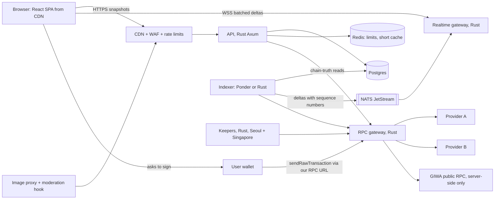

# Architecture plan (Phase 7)

Plan only. No production backend is built in this run. The prototype (`08-prototype/`) implements the front-end decisions against a mock `DataSource` and a mock `WalletPort`, so the real API and wallet stack drop in behind the same interfaces.

| ADR | Decision | Status |
|---|---|---|
| [F1](ADR-F1-frontend-stack.md) | React 19 + Vite 7 static SPA, prerendered marketing routes, chosen on bake-off evidence | accepted; the prototype is built on it |
| [B1](ADR-B1-backend-rust.md) | Rust (Axum, Tokio, alloy, sqlx) for the API, realtime gateway, RPC gateway and keepers; snapshot + batched deltas | proposed |
| [B2](ADR-B2-indexer-bakeoff.md) | Indexer bake-off: Ponder (TS) vs Rust (alloy) behind a fixed indexer-to-gateway contract | proposed (spike plan) |
| [E1](ADR-E1-edge-scale.md) | CDN, WAF, rate limits, bot defence, caching, autoscaling, backpressure, honest degradation; k6 load and soak plan | proposed |
| [S1](ADR-S1-security.md) | Strict CSP, SRI, zero third-party runtime scripts, supply chain, UGC as text, simulation before signing, account hardening, incident runbook | proposed; front-end half applied in the prototype |
| [O1](ADR-O1-observability-ci.md) | Logs, metrics, traces, RUM, error tracking, CI with Lighthouse and bundle budgets | proposed |

Evidence: `bakeoff/` (spike source, `measure.mjs`, `results.md`).

## System at a glance

## Where this departs from the masterplan

| Area | Masterplan | This plan | Why | Log |
|---|---|---|---|---|
| Front-end framework | Next.js 16 App Router, RSC, ISR `[05 §2, §13]` | React + Vite static SPA, build-time prerender | strict CSP without inline scripts on a static CDN; smaller runtime (F1) | Q20 |
| API, realtime, keepers | Vercel Route Handlers, SSE from Postgres `NOTIFY`, Node keepers `[05 §4, §5, §8]` | Rust services, WebSocket gateway with batched deltas | the brief asks for Rust in the connection-heavy parts (B1) | Q19 |
| Bot protection | Cloudflare Turnstile `[05 §10]` | edge bot management + rate limits; no in-page challenge script | "zero third-party scripts at runtime" (S1) | Q22 |
| Embedded wallet | provider open: Privy / Turnkey / Web3Auth `[05 §2]` | allowed only as a scoped, on-intent exception (`frame-src` for one origin) | provider code is third-party by nature (S1) | Q21 |

Kept from the masterplan: trading never depends on the API (quotes and state from chain reads) `[05 §2]`; three RPC providers with health-scored failover `[05 §11]`; Ponder as an indexer candidate `[05 §3]`; Postgres; two regions (Seoul + Singapore) `[05 §8]`; the three health indicators (chain, indexer, app) `[05 §11]`; UI update within 1 s of a block `[05 §5]`.
